# Computer Graphics and Virtual Reality Lab

**Student Name:** Likith S G  
**USN:** 1RVU23CSE236  
**Repository Name:** Computer-Graphics-and-Virtual-Reality  

This repository contains the complete laboratory curriculum for the **Computer Graphics and Virtual Reality (CGVR)** laboratory course. It includes ten laboratory experiments implemented independently in Python using PyOpenGL, GLUT, and GLFW. Each experiment provides full theoretical documentation, algorithmic workflows, mathematical formulas, and actual execution results.

---

## Table of Contents
- [Laboratory Experiments Overview](#laboratory-experiments-overview)
- [Experiment 1: DDA and Bresenham Line Drawing Algorithms](#experiment-1-dda-and-bresenham-line-drawing-algorithms)
- [Experiment 2: Midpoint Circle Drawing Algorithm](#experiment-2-midpoint-circle-drawing-algorithm)
- [Experiment 3: 2D Transformations Using Homogeneous Coordinates](#experiment-3-2d-transformations-using-homogeneous-coordinates)
- [Experiment 4: Composite 2D Transformations Using Matrix Representation](#experiment-4-composite-2d-transformations-using-matrix-representation)
- [Experiment 5: Cohen–Sutherland Line Clipping Algorithm](#experiment-5-cohensutherland-line-clipping-algorithm)
- [Experiment 6: Z-Buffer Algorithm for Hidden Surface Removal](#experiment-6-z-buffer-algorithm-for-hidden-surface-removal)
- [Experiment 7: Phong Illumination Model for a 3D Object](#experiment-7-phong-illumination-model-for-a-3d-object)
- [Experiment 8: OpenGL Vertex and Fragment Shaders](#experiment-8-opengl-vertex-and-fragment-shaders)
- [Experiment 9: Simple Interactive 3D Scene](#experiment-9-simple-interactive-3d-scene)
- [Experiment 10: 3D Viewing Pipeline, Projection, and Viewport Mapping](#experiment-10-3d-viewing-pipeline-projection-and-viewport-mapping)
- [Case Study 2: VR Collaborative Automotive Design (Industrial Design & Architecture)](#case-study-2-vr-collaborative-automotive-design)
- [Installation and Setup](#installation-and-setup)
- [Execution Commands](#execution-commands)
- [Repository Structure](#repository-structure)

---

## Laboratory Experiments Overview

| Sl. No. | Laboratory Experiment | Directory | Source Code | Visual Output |
|:---:|:---|:---:|:---:|:---:|
| **1** | [DDA and Bresenham Line Drawing](#experiment-1-dda-and-bresenham-line-drawing-algorithms) | [`experiments/Experiment_1/`](experiments/Experiment_1/) | [`exp1.py`](experiments/Experiment_1/exp1.py) | [Screenshot](experiments/Experiment_1/output.png) |
| **2** | [Midpoint Circle Drawing](#experiment-2-midpoint-circle-drawing-algorithm) | [`experiments/Experiment_2/`](experiments/Experiment_2/) | [`exp2.py`](experiments/Experiment_2/exp2.py) | [Screenshot](experiments/Experiment_2/output.png) |
| **3** | [2D Transformations Using Homogeneous Coordinates](#experiment-3-2d-transformations-using-homogeneous-coordinates) | [`experiments/Experiment_3/`](experiments/Experiment_3/) | [`exp3.py`](experiments/Experiment_3/exp3.py) | [Screenshot](experiments/Experiment_3/output.png) |
| **4** | [Composite 2D Transformations](#experiment-4-composite-2d-transformations-using-matrix-representation) | [`experiments/Experiment_4/`](experiments/Experiment_4/) | [`exp4.py`](experiments/Experiment_4/exp4.py) | [Screenshot](experiments/Experiment_4/output.png) |
| **5** | [Cohen–Sutherland Line Clipping](#experiment-5-cohensutherland-line-clipping-algorithm) | [`experiments/Experiment_5/`](experiments/Experiment_5/) | [`exp5.py`](experiments/Experiment_5/exp5.py) | [Screenshot](experiments/Experiment_5/output.png) |
| **6** | [Z-Buffer Hidden Surface Removal](#experiment-6-z-buffer-algorithm-for-hidden-surface-removal) | [`experiments/Experiment_6/`](experiments/Experiment_6/) | [`exp6.py`](experiments/Experiment_6/exp6.py) | [Screenshot](experiments/Experiment_6/output.png) |
| **7** | [Phong Illumination Model](#experiment-7-phong-illumination-model-for-a-3d-object) | [`experiments/Experiment_7/`](experiments/Experiment_7/) | [`exp7.py`](experiments/Experiment_7/exp7.py) | [Screenshot](experiments/Experiment_7/output.png) |
| **8** | [OpenGL Vertex and Fragment Shaders](#experiment-8-opengl-vertex-and-fragment-shaders) | [`experiments/Experiment_8/`](experiments/Experiment_8/) | [`exp8.py`](experiments/Experiment_8/exp8.py) | [Screenshot](experiments/Experiment_8/output.png) &bull; [GIF](experiments/Experiment_8/anim.gif) |
| **9** | [Simple Interactive 3D Scene](#experiment-9-simple-interactive-3d-scene) | [`experiments/Experiment_9/`](experiments/Experiment_9/) | [`exp9.py`](experiments/Experiment_9/exp9.py) | [Screenshot](experiments/Experiment_9/output.png) &bull; [GIF](experiments/Experiment_9/demo.gif) |
| **10** | [3D Viewing Pipeline & Projection](#experiment-10-3d-viewing-pipeline-projection-and-viewport-mapping) | [`experiments/Experiment_10/`](experiments/Experiment_10/) | [`exp10.py`](experiments/Experiment_10/exp10.py) | [Screenshot](experiments/Experiment_10/output.png) &bull; [GIF](experiments/Experiment_10/demo.gif) |

---

## Experiment 1: DDA and Bresenham Line Drawing Algorithms

**Location:** [`experiments/Experiment_1/`](experiments/Experiment_1/) &bull; **Program:** [`experiments/Experiment_1/exp1.py`](experiments/Experiment_1/exp1.py)

### 1. Objective
To implement and comparatively evaluate the Digital Differential Analyzer (DDA) and Bresenham line generation algorithms on a discrete raster grid.

### 2. Concept Overview
- **DDA:** A differential approach that determines pixel positions along the line by incrementing coordinates with floating-point values and rounding to the nearest discrete pixel center.
- **Bresenham's Line Algorithm:** An exact, optimized rasterization technique utilizing strictly integer arithmetic. It tracks an error term representing the vertical/horizontal deviation between the continuous line and the grid point, completely avoiding floating-point division.

### 3. Algorithm & Important Steps
1. Calculate delta differences: $\Delta x = x_2 - x_1$, $\Delta y = y_2 - y_1$.
2. **For DDA:**
   - Determine driving step count: $\text{steps} = \max(|\Delta x|, |\Delta y|)$.
   - Compute coordinate increments: $x_{\text{inc}} = \Delta x / \text{steps}$, $y_{\text{inc}} = \Delta y / \text{steps}$.
   - At each iteration from $0$ to $\text{steps}$, plot $(\text{round}(x), \text{round}(y))$ and increment $(x, y)$.
3. **For Bresenham:**
   - Set step directions $s_x = \text{sign}(\Delta x)$, $s_y = \text{sign}(\Delta y)$.
   - Initialize error: $\text{err} = |\Delta x| - |\Delta y|$.
   - Loop: plot $(x_1, y_1)$. Evaluate $e_2 = 2 \cdot \text{err}$. If $e_2 > -|\Delta y|$, update $\text{err} \mathrel{-}= |\Delta y|$ and $x_1 \mathrel{+}= s_x$. If $e_2 < |\Delta x|$, update $\text{err} \mathrel{+}= |\Delta x|$ and $y_1 \mathrel{+}= s_y$.

### 4. Mathematical Formulas
$$\text{DDA: } x_{k+1} = x_k + \frac{\Delta x}{\max(|\Delta x|, |\Delta y|)}, \quad y_{k+1} = y_k + \frac{\Delta y}{\max(|\Delta x|, |\Delta y|)}$$
$$\text{Bresenham Error: } \text{err}_0 = \Delta x - \Delta y, \quad e_2 = 2 \cdot \text{err}$$

### 5. Implementation Details
The script renders a red line using DDA from $(80, 130)$ to $(580, 500)$ and an emerald green line using Bresenham from $(80, 520)$ to $(580, 110)$, accompanied by an annotated coordinate grid and legend.

### 6. Visual Result
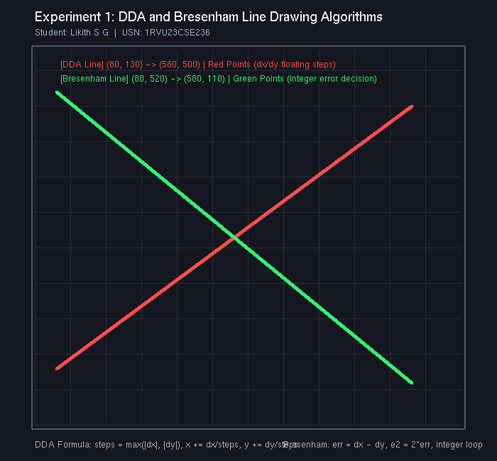

*Visual output: DDA line (coral red) and Bresenham line (emerald green) plotted on discrete raster grid.*

### 7. Execution Command
```bash
python experiments/Experiment_1/exp1.py
```

---

## Experiment 2: Midpoint Circle Drawing Algorithm

**Location:** [`experiments/Experiment_2/`](experiments/Experiment_2/) &bull; **Program:** [`experiments/Experiment_2/exp2.py`](experiments/Experiment_2/exp2.py)

### 1. Objective
To rasterize circles using the Midpoint Circle Drawing Algorithm, taking advantage of 8-way symmetry and integer-only decision parameters.

### 2. Concept Overview
The circle function is defined as $f(x, y) = x^2 + y^2 - r^2$. Testing the midpoint between the East pixel $(x+1, y)$ and South-East pixel $(x+1, y-1)$ reveals whether the circle boundary passes above or below the midpoint. Because circles are symmetric across octants, calculating one octant ($x = 0$ to $x = y$) suffices to plot all eight octants simultaneously.

### 3. Algorithm & Important Steps
1. Set starting point $(x, y) = (0, r)$.
2. Calculate initial decision parameter $p_0 = 1 - r$.
3. Plot all 8 symmetric points: $(x_c \pm x, y_c \pm y)$ and $(x_c \pm y, y_c \pm x)$.
4. While $x < y$:
   - Increment $x \leftarrow x + 1$.
   - If $p_k < 0$: midpoint inside circle $\implies p_{k+1} = p_k + 2x + 1$.
   - If $p_k \ge 0$: midpoint outside circle $\implies y \leftarrow y - 1, p_{k+1} = p_k + 2(x - y) + 1$.
   - Plot 8 symmetric points.

### 4. Mathematical Formulas
$$p_0 = 1 - r$$
$$p_{k+1} = \begin{cases} p_k + 2x_{k+1} + 1 & \text{if } p_k < 0 \\ p_k + 2(x_{k+1} - y_{k+1}) + 1 & \text{if } p_k \ge 0 \end{cases}$$

### 5. Implementation Details
The program renders a primary green circle centered at $(350, 310)$ with radius $R = 175$, an inner concentric cyan circle ($R = 90$), center marker, radius lines, and 8-fold symmetry guidelines.

### 6. Visual Result
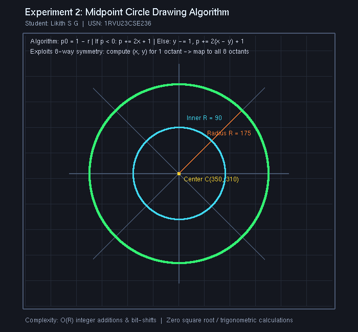

*Visual output: Dual concentric circles drawn using the midpoint decision parameter and 8-way symmetric plotting.*

### 7. Execution Command
```bash
python experiments/Experiment_2/exp2.py
```

---

## Experiment 3: 2D Transformations Using Homogeneous Coordinates

**Location:** [`experiments/Experiment_3/`](experiments/Experiment_3/) &bull; **Program:** [`experiments/Experiment_3/exp3.py`](experiments/Experiment_3/exp3.py)

### 1. Objective
To implement 2D geometric transformations (Translation, Rotation, Scaling, Reflection, and Shearing) using $3 \times 3$ homogeneous coordinate matrices.

### 2. Concept Overview
Cartesian coordinates require vector addition for translation and matrix multiplication for rotation/scaling. By augmenting points to 3D projective homogeneous coordinates ($[x, y, 1]^T$), all affine operations are expressed as unified $3 \times 3$ matrix multiplications.

### 3. Algorithm & Important Steps
1. Represent polygon vertices as column vectors $P_i = [x_i, y_i, 1]^T$.
2. Construct the corresponding $3 \times 3$ transformation matrix $M$.
3. Compute transformed coordinates $P'_i = M \times P_i$.
4. Convert back to Cartesian space $(x' = x'_h / w'_h, y' = y'_h / w'_h)$ and draw transformed polygons.

### 4. Mathematical Formulas
$$\text{Translation: } T(t_x, t_y) = \begin{bmatrix} 1 & 0 & t_x \\ 0 & 1 & t_y \\ 0 & 0 & 1 \end{bmatrix}, \quad \text{Rotation: } R(\theta) = \begin{bmatrix} \cos\theta & -\sin\theta & 0 \\ \sin\theta & \cos\theta & 0 \\ 0 & 0 & 1 \end{bmatrix}$$
$$\text{Scaling: } S(s_x, s_y) = \begin{bmatrix} s_x & 0 & 0 \\ 0 & s_y & 0 \\ 0 & 0 & 1 \end{bmatrix}, \quad \text{Shear: } Sh(sh_x, shy) = \begin{bmatrix} 1 & sh_x & 0 \\ sh_y & 1 & 0 \\ 0 & 0 & 1 \end{bmatrix}$$

### 5. Implementation Details
The application renders 6 synchronized panels displaying the original geometry (gray) against transformed geometry (colored) with explicit matrix displays for Translation, Rotation ($+45^\circ$), Scaling ($1.5x, 0.7x$), Reflection across X-axis, Shearing, and Homogeneous theory.

### 6. Visual Result
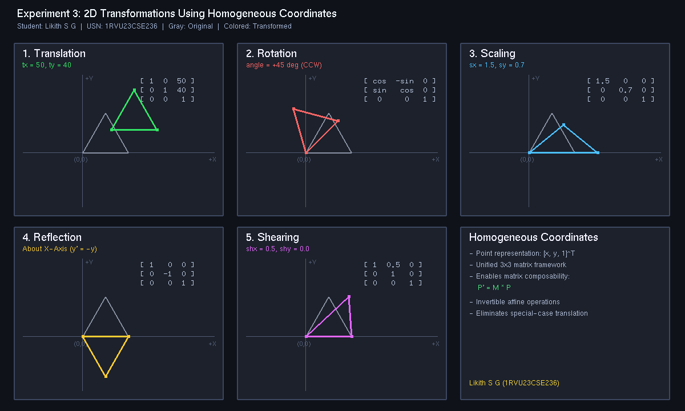

*Visual output: 6-panel grid comparing original vs transformed geometries with parameter matrices.*

### 7. Execution Command
```bash
python experiments/Experiment_3/exp3.py
```

---

## Experiment 4: Composite 2D Transformations Using Matrix Representation

**Location:** [`experiments/Experiment_4/`](experiments/Experiment_4/) &bull; **Program:** [`experiments/Experiment_4/exp4.py`](experiments/Experiment_4/exp4.py)

### 1. Objective
To implement composite 2D transformations using homogeneous coordinate matrix multiplication, demonstrating sequential pipelines and matrix non-commutativity.

### 2. Concept Overview
Applying multiple transformations individually requires multiple vertex traversals. Concatenating transformation matrices into a single composite matrix $M = T \times R \times S$ allows every vertex to be updated in a single operation ($P' = M \times P$). Because matrix multiplication is non-commutative ($A \times B \ne B \times A$), operations are strictly evaluated from right to left.

### 3. Algorithm & Important Steps
1. Define primitive polygon vertices in homogeneous coordinates.
2. Build scaling matrix $S(1.6, 1.6)$, rotation matrix $R(+45^\circ)$, and translation matrix $T(140, 100)$.
3. Compute composite matrix: $M = T \times (R \times S)$.
4. Apply composite matrix to all vertices: $P' = M \times P$.
5. Render intermediate geometric states (Scaled, Rotated) alongside the final composite state.

### 4. Mathematical Formulas
$$M = T(t_x, t_y) \times R(\theta) \times S(s_x, s_y)$$
$$P' = M \times P \quad \text{where } T \times R \times S \neq S \times R \times T$$

### 5. Implementation Details
The program displays the transformation progression on a coordinate stage: Original (gray), Scaled (cyan), Rotated (yellow), and Final Composite (vibrant red-coral), alongside four formatted matrix boxes displaying numerical matrix components.

### 6. Visual Result
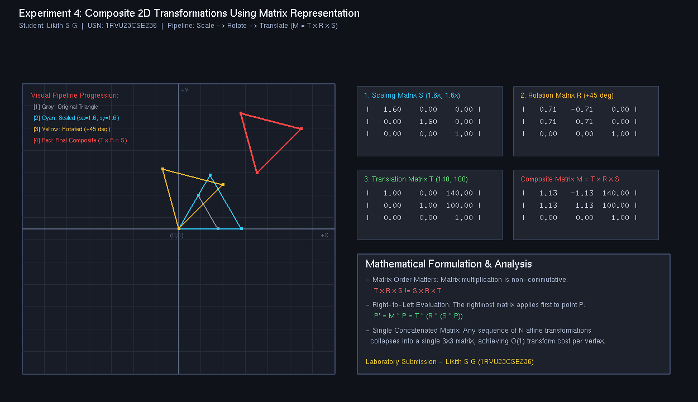

*Visual output: Progression of composite affine pipeline (Scale -> Rotate -> Translate) and computed 3x3 matrices.*

### 7. Execution Command
```bash
python experiments/Experiment_4/exp4.py
```

---

## Experiment 5: Cohen–Sutherland Line Clipping Algorithm

**Location:** [`experiments/Experiment_5/`](experiments/Experiment_5/) &bull; **Program:** [`experiments/Experiment_5/exp5.py`](experiments/Experiment_5/exp5.py)

### 1. Objective
To implement the **Cohen–Sutherland Line Clipping Algorithm** in Python using OpenGL to clip line segments against a rectangular window.

### 2. Concept Overview
The algorithm divides 2D space into nine regions relative to a clipping boundary $[X_{\min}, X_{\max}] \times [Y_{\min}, Y_{\max}]$. Each endpoint is assigned a 4-bit outcode: `[TOP, BOTTOM, RIGHT, LEFT]`. Bitwise operations enable rapid identification of lines entirely inside (trivial accept) or completely on one outside side (trivial reject). Partially overlapping lines are clipped iteratively at window boundaries.

### 3. Algorithm & Important Steps
1. Compute outcodes `code1` and `code2` for endpoints $(x_1, y_1)$ and $(x_2, y_2)$.
2. Loop:
   - If `code1 == 0` and `code2 == 0`: Trivial Accept.
   - If `(code1 & code2) != 0`: Trivial Reject.
   - Otherwise, select the outside endpoint and find its intersection with the corresponding boundary ($y = Y_{\max}, y = Y_{\min}, x = X_{\max}, \text{ or } x = X_{\min}$). Replace the outside point with the intersection and recompute its outcode.

### 4. Mathematical Formulas
$$\text{Top: } x = x_1 + (x_2 - x_1) \frac{Y_{\max} - y_1}{y_2 - y_1}, \quad \text{Bottom: } x = x_1 + (x_2 - x_1) \frac{Y_{\min} - y_1}{y_2 - y_1}$$
$$\text{Right: } y = y_1 + (y_2 - y_1) \frac{X_{\max} - x_1}{x_2 - x_1}, \quad \text{Left: } y = y_1 + (y_2 - y_1) \frac{X_{\min} - x_1}{x_2 - x_1}$$

### 5. Implementation Details
The visual layout features 3 panels:
- Panel 1: Original input lines before clipping.
- Panel 2: Clipped lines showing retained segments in vibrant green and rejected segments in faint gray.
- Panel 3: 4-bit region code grid diagram, bitwise decision rules, and mathematical formulas.

### 6. Visual Result
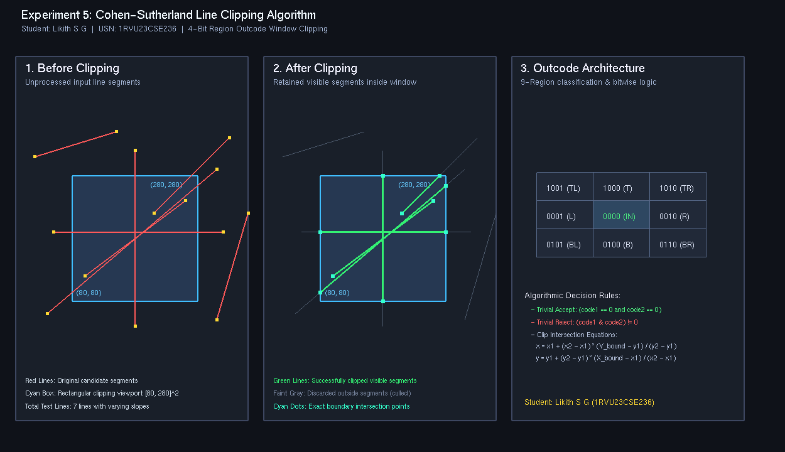

*Visual output: Side-by-side comparison of unclipped lines, clipped results, and the 9-region outcode architecture.*

### 7. Execution Command
```bash
python experiments/Experiment_5/exp5.py
```

---

## Experiment 6: Z-Buffer Algorithm for Hidden Surface Removal

**Location:** [`experiments/Experiment_6/`](experiments/Experiment_6/) &bull; **Program:** [`experiments/Experiment_6/exp6.py`](experiments/Experiment_6/exp6.py)

### 1. Objective
To implement and analyze the **Z-Buffer (Depth-Buffer) Algorithm** for hidden surface removal, demonstrating per-fragment depth testing and contrasting it with the failure of the naive Painter's Algorithm.

### 2. Concept Overview
The Z-buffer algorithm operates in image space. A dedicated depth buffer stores the closest $Z$-depth encountered for each screen pixel $(x, y)$. When rendering a polygon fragment, if its depth is closer than the value in the depth buffer, the depth buffer is updated and the color is written. Otherwise, the fragment is occluded and discarded.

### 3. Algorithm & Important Steps
1. Clear color buffer to background color and depth buffer to maximum depth ($1.0$).
2. For each polygon fragment $(x, y)$ with depth $z$:
   - If $z < Z_{\text{buffer}}(x, y)$:
     - $Z_{\text{buffer}}(x, y) \leftarrow z$
     - $\text{ColorBuffer}(x, y) \leftarrow \text{Color}_{\text{polygon}}$
   - Else discard fragment.

### 4. Mathematical Formulas
$$z = \frac{-Ax - By - D}{C} \quad \text{for plane } Ax + By + Cz + D = 0$$
Along a scanline:
$$z(x+1, y) = z(x, y) - \frac{A}{C}$$

### 5. Implementation Details
The application provides dual viewports comparing:
- Left Viewport: Depth Testing DISABLED (naive Painter's failure where drawing order causes green and blue triangles to overwrite the closer red triangle).
- Right Viewport: Depth Testing ENABLED (`GL_LESS`), properly keeping the closer red triangle in front.

### 6. Visual Result
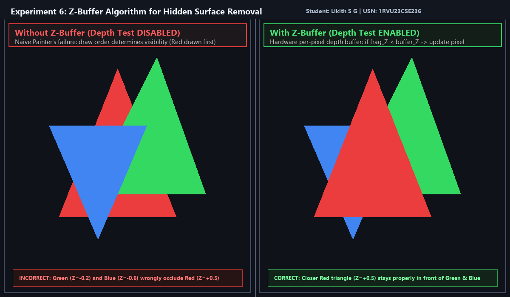

*Visual output: Side-by-side comparison proving correct hidden surface removal when the depth buffer is enabled.*

### 7. Execution Command
```bash
python experiments/Experiment_6/exp6.py
```

---

## Experiment 7: Phong Illumination Model for a 3D Object

**Location:** [`experiments/Experiment_7/`](experiments/Experiment_7/) &bull; **Program:** [`experiments/Experiment_7/exp7.py`](experiments/Experiment_7/exp7.py)

### 1. Objective
To implement the **Phong Illumination Model** for a 3D object in Python using OpenGL and GLFW, analyzing the decomposition into Ambient, Diffuse, and Specular components.

### 2. Concept Overview
The Phong model evaluates total reflected light intensity as the sum of three components:
1. **Ambient Light ($I_{\text{ambient}}$):** Omnidirectional baseline environmental scattering.
2. **Diffuse Light ($I_{\text{diffuse}}$):** Lambertian cosine scattering from matte surfaces.
3. **Specular Light ($I_{\text{specular}}$):** Glossy mirror highlight directed along the reflection vector.

### 3. Algorithm & Important Steps
1. Compute normalized surface normal $\vec{N}$, light direction $\vec{L}$, and camera vector $\vec{V} = (0, 0, 1)$.
2. Calculate reflected light direction: $\vec{R} = 2(\vec{N} \cdot \vec{L})\vec{N} - \vec{L}$.
3. Evaluate Ambient: $I_{\text{amb}} = k_a I_a$.
4. Evaluate Diffuse: $I_{\text{diff}} = k_d \max(0, \vec{N} \cdot \vec{L}) I_d$.
5. Evaluate Specular: $I_{\text{spec}} = k_s \max(0, \vec{R} \cdot \vec{V})^\alpha I_s$.
6. Combine components: $I = I_{\text{amb}} + I_{\text{diff}} + I_{\text{spec}}$.

### 4. Mathematical Formulas
$$I = k_a I_a + k_d (\vec{N} \cdot \vec{L}) I_d + k_s (\vec{R} \cdot \vec{V})^\alpha I_s$$
$$\vec{R} = 2(\vec{N} \cdot \vec{L})\vec{N} - \vec{L}, \quad \alpha = 32.0$$

### 5. Implementation Details
The window displays four synchronized quadrants:
1. Top-Left: Ambient component ($I_{\text{amb}}$).
2. Top-Right: Diffuse component ($I_{\text{diff}}$).
3. Bottom-Left: Specular highlight ($I_{\text{spec}}$).
4. Bottom-Right: Complete combined Phong illumination model.

### 6. Visual Result
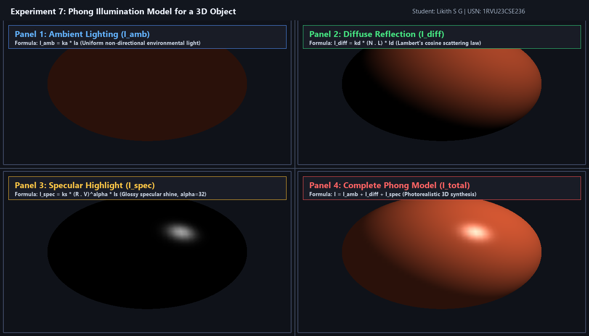

*Visual output: 4-quadrant decomposition of Ambient, Diffuse, Specular, and complete Phong shading on a 3D sphere.*

### 7. Execution Command
```bash
python experiments/Experiment_7/exp7.py
```

---

## Experiment 8: OpenGL Vertex and Fragment Shaders

**Location:** [`experiments/Experiment_8/`](experiments/Experiment_8/) &bull; **Program:** [`experiments/Experiment_8/exp8.py`](experiments/Experiment_8/exp8.py)

### 1. Objective
To develop a modern programmable OpenGL application using **GLSL 3.3 Core Profile**, implementing GPU buffer objects (VAO/VBO), vertex transformations in the Vertex Shader, and dynamic color pulsation in the Fragment Shader.

### 2. Concept Overview
Modern graphics APIs utilize programmable pipelines executing custom GLSL shaders on the GPU. The Vertex Shader processes per-vertex attributes (coordinates, colors) and applies model transformations. The Fragment Shader receives rasterized interpolated attributes and calculates final pixel colors with dynamic effects.

### 3. Algorithm & Important Steps
1. Compile and link GLSL 3.3 Vertex and Fragment Shaders into a shader program.
2. Interleave vertex positions $(x, y, z)$ and colors $(r, g, b)$ into a Vertex Buffer Object (VBO).
3. Configure attribute layout pointers in a Vertex Array Object (VAO).
4. In render loop, pass dynamic uniforms (`angle`, `time`) to shaders, bind VAO, and issue draw calls (`glDrawArrays`).

### 4. Mathematical Formulas and Shader Architecture
- **Vertex Rotation (GPU Vertex Shader):**
  $$\begin{bmatrix} x' \\ y' \end{bmatrix} = \begin{bmatrix} \cos\theta & -\sin\theta \\ \sin\theta & \cos\theta \end{bmatrix} \begin{bmatrix} x \\ y \end{bmatrix}, \quad \text{gl\_Position} = \begin{bmatrix} x' \\ y' \\ z \\ 1.0 \end{bmatrix}$$
- **Fragment Color Pulsation (GPU Fragment Shader):**
  $$\text{pulse}(t) = 0.5 + 0.5 \sin(3.0 \cdot t)$$
  $$\text{FragColor} = \text{vec4}(\text{vertexColor} \times (0.75 + 0.25 \cdot \text{pulse}(t)), 1.0)$$

### 5. Implementation Details
Modern OpenGL 3.3 Core Profile implementation with VAO/VBO management, continuous rotation and color pulsation, capturing both high-resolution static output and live animated GIF.

### 6. Visual Result

#### Static Frame Screenshot
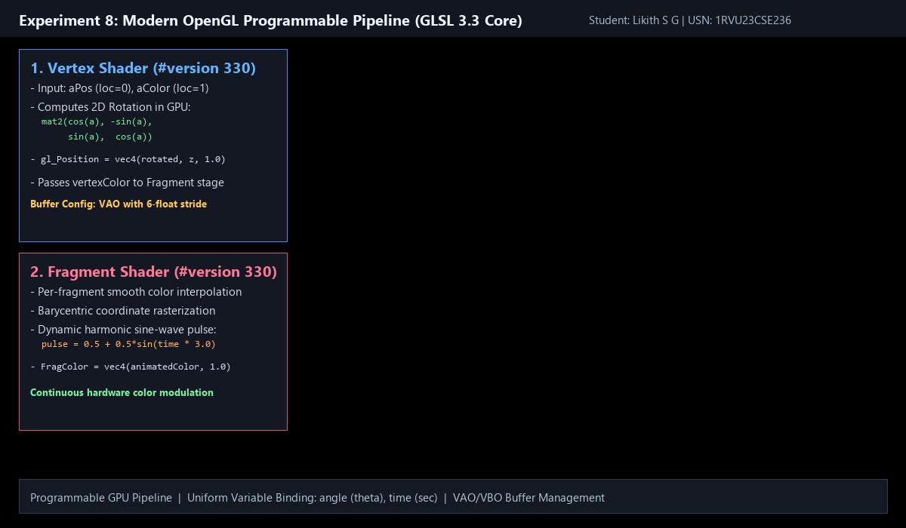

#### Live Shader Animation (GIF)
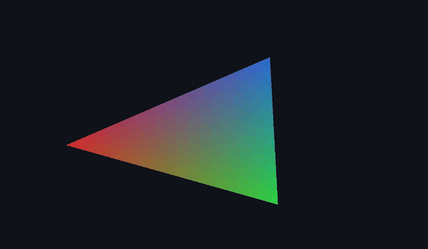

*Live animation: Real-time GPU vertex rotation and fragment color pulsation.*

### 7. Execution Command
```bash
python experiments/Experiment_8/exp8.py
```

---

## Experiment 9: Simple Interactive 3D Scene

**Location:** [`experiments/Experiment_9/`](experiments/Experiment_9/) &bull; **Program:** [`experiments/Experiment_9/exp9.py`](experiments/Experiment_9/exp9.py)

### 1. Objective
To construct an interactive 3D virtual environment demonstrating virtual reality engine architecture (as found in Unity) directly in Python using OpenGL.

### 2. Concept Overview
An interactive 3D virtual scene combines scene graph geometry, lighting, player kinematic simulation with gravity, a third-person camera follower, proximity collision detection, and a real-time Heads-Up Display (HUD).

### 3. Algorithm & Important Steps
1. Construct checkered arena ground grid, boundary lines, and 3D obstacle blocks.
2. Implement player kinematics with forward/backward displacement, steering rotation, and Euler numerical gravity integration for jump physics.
3. Compute dynamic third-person following camera position behind the player using `gluLookAt`.
4. Animate collectible diamond gems with continuous yaw rotation and vertical harmonic bobbing.
5. Check Euclidean proximity distance between player and gems to trigger collection and update score.
6. Overlay 2D telemetry HUD showing coordinates, state, and keybindings.

### 4. Mathematical Formulas
- **Player Kinematics:** $\Delta x = -v \cdot \Delta t \cdot \sin(\theta), \quad \Delta z = -v \cdot \Delta t \cdot \cos(\theta)$
- **Euler Gravity:** $v_y(t + \Delta t) = v_y(t) - g \cdot \Delta t, \quad y(t + \Delta t) = y(t) + v_y(t) \cdot \Delta t$
- **Third-Person Camera Tracking:**
  $$C_x = P_x - d \cdot \sin(\theta), \quad C_z = P_z + d \cdot \cos(\theta), \quad C_y = P_y + h$$
- **Proximity Trigger:** $(P_x - C_x)^2 + (P_z - C_z)^2 < 1.4\text{ m}^2$

### 5. Implementation Details
Features an interactive arena, player avatar with steering and jumping, rotating diamond gems, HUD score counter, and support for WASD/Arrow keys, Space to jump, and R to reset.

### 6. Visual Result

#### Python OpenGL Output
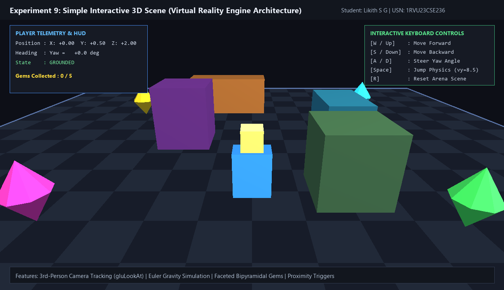

#### Python Interactive Demo (GIF)


#### Unity 3D Interactive Scene (Unity 6 / 2022.3 LTS)
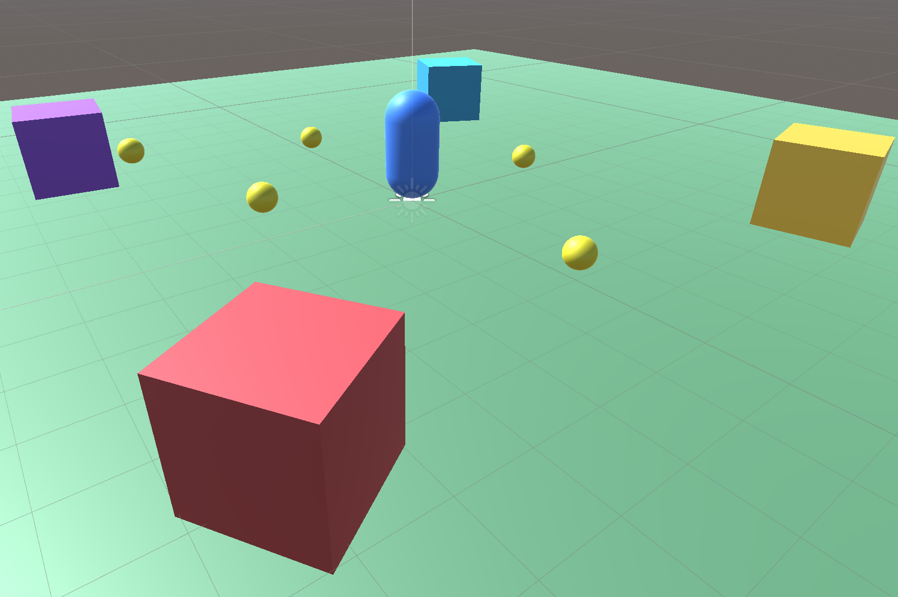

#### Unity 3D Gameplay & Physics Demo (GIF)
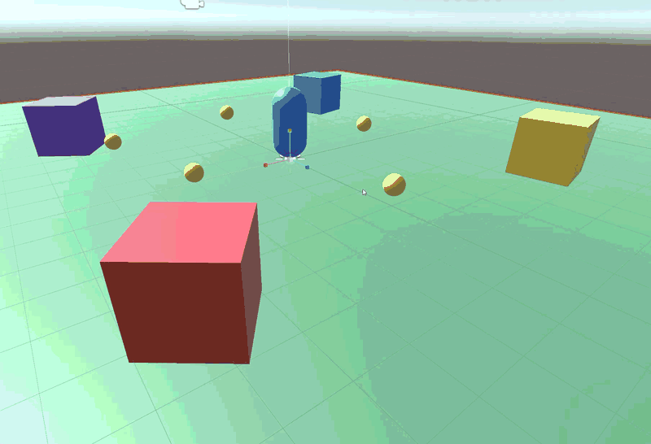

*Demonstrates third-person player locomotion, Euler jump kinematics, rotating diamond gems, trigger pickups, and real-time telemetry HUD across both Python and Unity 3D engines.*

### 7. Execution Command
```bash
python experiments/Experiment_9/exp9.py
```

---

## Experiment 10: 3D Viewing Pipeline, Projection, and Viewport Mapping

**Location:** [`experiments/Experiment_10/`](experiments/Experiment_10/) &bull; **Program:** [`experiments/Experiment_10/exp10.py`](experiments/Experiment_10/exp10.py)

### 1. Objective
To implement the complete **3D Viewing Pipeline**, demonstrating coordinate transformations from object space to screen space and comparing Orthographic vs. Perspective projection in synchronized side-by-side viewports.

### 2. Concept Overview
The 3D viewing transformation pipeline converts 3D geometric models into 2D display pixels:
$$\text{[Object Space]} \xrightarrow{M_{\text{model}}} \text{[World Space]} \xrightarrow{M_{\text{view}}} \text{[Eye Space]} \xrightarrow{M_{\text{proj}}} \text{[Clip Space]} \xrightarrow{\text{Perspective Division}} \text{[NDC]} \xrightarrow{\text{Viewport}} \text{[Screen]}$$
- **Orthographic Projection:** Parallel projectors maintain exact Euclidean dimensions and parallel lines without foreshortening (used in CAD and blueprints).
- **Perspective Projection:** Projectors converge at the camera lens, producing depth foreshortening where distant objects appear smaller (mimicking natural human vision).

### 3. Algorithm & Important Steps
1. Define 3D cube model geometry with colored faces and wireframe edges.
2. Establish view transformation using `gluLookAt` from camera position $(4.0, 3.2, 6.0)$ targeting origin $(0, 0, 0)$.
3. In Left Viewport: Apply `glOrtho` for distance-invariant orthographic projection.
4. In Right Viewport: Apply `gluPerspective` for foreshortened perspective projection.
5. In both viewports, apply synchronized model rotations and render geometry.

### 4. Mathematical Formulas
$$\text{View Matrix: } M_{\text{view}} = \begin{bmatrix} \vec{x}_c & -\vec{x}_c \cdot \vec{E} \\ \vec{y}_c & -\vec{y}_c \cdot \vec{E} \\ \vec{z}_c & -\vec{z}_c \cdot \vec{E} \\ \mathbf{0} & 1 \end{bmatrix}$$
$$\text{Orthographic Matrix: } M_{\text{ortho}} = \begin{bmatrix} \frac{2}{r-l} & 0 & 0 & -\frac{r+l}{r-l} \\ 0 & \frac{2}{t-b} & 0 & -\frac{t+b}{t-b} \\ 0 & 0 & -\frac{2}{f-n} & -\frac{f+n}{f-n} \\ 0 & 0 & 0 & 1 \end{bmatrix}$$
$$\text{Perspective Matrix: } M_{\text{persp}} = \begin{bmatrix} \frac{\cot(\theta/2)}{\text{aspect}} & 0 & 0 & 0 \\ 0 & \cot(\theta/2) & 0 & 0 \\ 0 & 0 & -\frac{f+n}{f-n} & -\frac{2fn}{f-n} \\ 0 & 0 & -1 & 0 \end{bmatrix}$$
$$\text{Viewport Mapping: } x_s = x_v + \frac{x_{\text{ndc}} + 1}{2} w_v, \quad y_s = y_v + \frac{y_{\text{ndc}} + 1}{2} h_v$$

### 5. Implementation Details
Features dual viewports with synchronized animated rotation of a multi-colored 3D cube, comparing parallel CAD-style orthographic projection against depth-foreshortened perspective projection.

### 6. Visual Result

#### Python OpenGL Output (Dual Viewports)
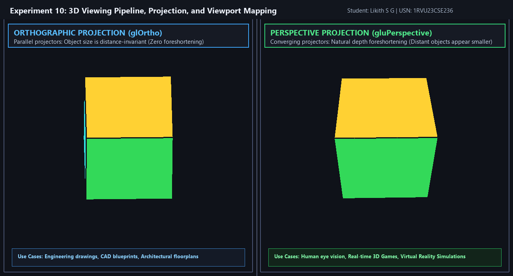

#### Python Interactive Demo (GIF)


#### Unity 3D Synchronized Dual Projection Pipeline
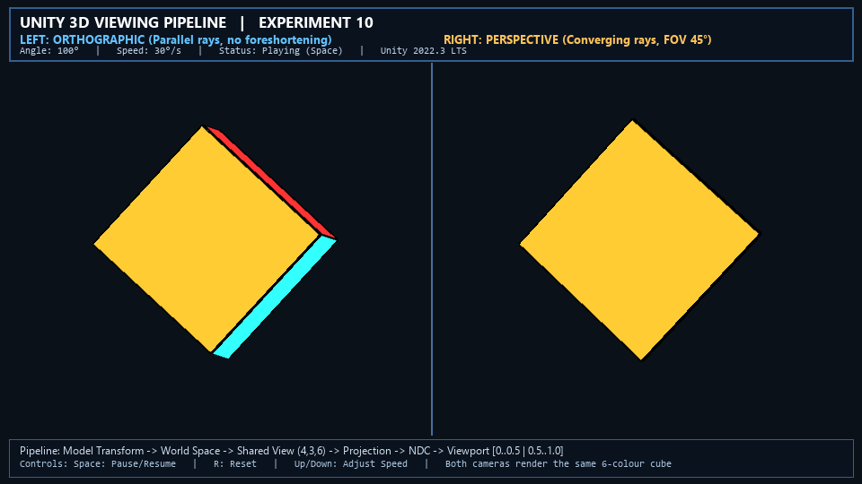

#### Unity 3D Synchronized Viewing Pipeline Demo (GIF)
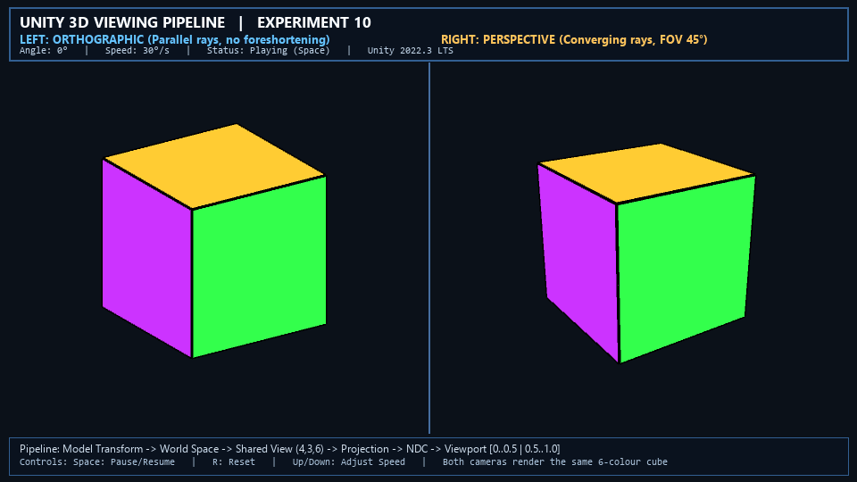

*Demonstrates the 3D viewing transformation pipeline comparing CAD-style parallel orthographic projection against depth-foreshortened perspective projection across both Python OpenGL and Unity 3D engines.*

### 7. Execution Command
```bash
python experiments/Experiment_10/exp10.py
```

---

## Case Study 2: VR Collaborative Automotive Design

**Location:** [`Case Study/`](Case Study/) &bull; **Documentation:** [`Case Study/README.md`](Case Study/README.md) &bull; **Unity Project:** [`Case Study/unity_project/`](Case Study/unity_project/)

### Scenario: Industrial Design & Architecture
An automotive manufacturer deploys a collaborative VR environment allowing design teams in **Bengaluru** and **Detroit** to view, manipulate, and validate 1:1 scale car prototypes concurrently without expensive physical clay models.

### Key Deliverables & Theory:
1. **Geometric Modelling:** B-Rep vs. CSG, NURBS surface formulations, and adaptive Delaunay tessellation for Class-A aerodynamic curvature continuity.
2. **Matrix Transformations:** Derivation and computation of the composite transformation matrix $\mathbf{M} = \mathbf{T}(50\text{ mm}) \cdot \mathbf{R}_z(45^\circ) \cdot \mathbf{S}(1.5)$ in homogeneous coordinates using the column-vector convention.
3. **VR Optimization & Clipping:** 4D Sutherland-Hodgman homogeneous frustum clipping, tri-level Hidden Surface Removal (Back-face culling, BVH occlusion queries, and Hi-Z Early-Z depth testing), Single-Pass Instanced Stereo rendering, and Variable Rate Shading (VRS) to maintain $90\text{ FPS}$ with $<20\text{ ms}$ motion-to-photon latency.
4. **Unity 6 Implementation:** Interactive 1:1 scale prototype review studio featuring real-time wheel rim transformation inspector, exploded assembly mode (`E`), metallic Class-A paint finish customizer (`C`), distributed collaborative avatars, and live VR optimization telemetry.

### Visual Result

#### Unity 6 Interactive Forza Customization Studio (Static View)


#### Unity 6 Interactive Design Review Demo (GIF)


*Showcases the 1:1 scale automotive design studio in Unity 6: 5 selectable vehicle models with PI ratings, modular wheel and body aero customization, interactive Q2 homogeneous transformation inspector, and real-time dual-eye VR telemetry.*

---

## Installation and Setup

### Prerequisites
- **Operating System:** Windows 10/11, Linux, or macOS.
- **Python:** Python 3.8+ (Tested on Python 3.10.11).
- **Graphics Hardware:** OpenGL 3.3 compatible graphics card / driver.

### 1. Clone or Download Repository
```bash
git clone https://github.com/likithsg/Computer-Graphics-and-Virtual-Reality.git
cd Computer-Graphics-and-Virtual-Reality
```

### 2. Install Required Python Dependencies
Install the required packages using `requirements.txt`:
```bash
pip install -r requirements.txt
```

Contents of `requirements.txt`:
- `PyOpenGL>=3.1.7`: OpenGL bindings for Python.
- `PyOpenGL-accelerate>=3.1.7`: C-accelerators for PyOpenGL.
- `glfw>=2.10.0`: Modern cross-platform windowing and OpenGL context library.
- `numpy>=1.24.0`: Array and matrix operations.
- `Pillow>=10.0.0`: Image processing and framebuffer capture.

### 3. OpenGL & GLUT System Setup on Windows
- **PyOpenGL & GLUT:** GLUT (`freeglut.dll`) is bundled automatically with the official Windows binary wheels of `PyOpenGL`. If GLUT is missing on a custom setup, place `freeglut.dll` in your Python directory or `C:\Windows\System32`.
- **GLFW:** The `glfw` package automatically installs pre-compiled native Windows binaries.

---

## Execution Commands

Each experiment can be executed independently from the repository root:

```bash
# Experiment 1: DDA and Bresenham Line Drawing
python experiments/Experiment_1/exp1.py

# Experiment 2: Midpoint Circle Drawing Algorithm
python experiments/Experiment_2/exp2.py

# Experiment 3: 2D Transformations Using Homogeneous Coordinates
python experiments/Experiment_3/exp3.py

# Experiment 4: Composite 2D Transformations Using Matrix Representation
python experiments/Experiment_4/exp4.py

# Experiment 5: Cohen–Sutherland Line Clipping Algorithm
python experiments/Experiment_5/exp5.py

# Experiment 6: Z-Buffer Algorithm for Hidden Surface Removal
python experiments/Experiment_6/exp6.py

# Experiment 7: Phong Illumination Model for a 3D Object
python experiments/Experiment_7/exp7.py

# Experiment 8: OpenGL Vertex and Fragment Shaders
python experiments/Experiment_8/exp8.py

# Experiment 9: Simple Interactive 3D Scene
python experiments/Experiment_9/exp9.py

# Experiment 10: 3D Viewing Pipeline, Projection, and Viewport Mapping
python experiments/Experiment_10/exp10.py
```

### Automated Headless Framebuffer Capture
All experiments support the `--headless` flag to render, capture, and save fresh output screenshots without keeping an interactive window open:
```bash
python experiments/Experiment_1/exp1.py --headless
python experiments/Experiment_2/exp2.py --headless
python experiments/Experiment_3/exp3.py --headless
python experiments/Experiment_4/exp4.py --headless
python experiments/Experiment_5/exp5.py --headless
python experiments/Experiment_6/exp6.py --headless
python experiments/Experiment_7/exp7.py --headless
python experiments/Experiment_8/exp8.py --headless
python experiments/Experiment_9/exp9.py --headless
python experiments/Experiment_10/exp10.py --headless
```

---

## Repository Structure

```text
Computer-Graphics-and-Virtual-Reality/
│
├── experiments/
│   ├── README.md
│   ├── Experiment_1/
│   │   ├── exp1.py
│   │   ├── output.png
│   │   └── README.md
│   ├── Experiment_2/
│   │   ├── exp2.py
│   │   ├── output.png
│   │   └── README.md
│   ├── Experiment_3/
│   │   ├── exp3.py
│   │   ├── output.png
│   │   └── README.md
│   ├── Experiment_4/
│   │   ├── exp4.py
│   │   ├── output.png
│   │   └── README.md
│   ├── Experiment_5/
│   │   ├── exp5.py
│   │   ├── output.png
│   │   └── README.md
│   ├── Experiment_6/
│   │   ├── exp6.py
│   │   ├── output.png
│   │   └── README.md
│   ├── Experiment_7/
│   │   ├── exp7.py
│   │   ├── output.png
│   │   └── README.md
│   ├── Experiment_8/
│   │   ├── exp8.py
│   │   ├── output.png
│   │   ├── anim.gif
│   │   └── README.md
│   ├── Experiment_9/
│   │   ├── exp9.py
│   │   ├── output.png
│   │   ├── demo.gif
│   │   └── README.md
│   └── Experiment_10/
│       ├── exp10.py
│       ├── output.png
│       ├── demo.gif
│       └── README.md
│
├── Case Study/
│   ├── README.md
│   ├── verify_matrix.py
│   └── unity_project/
│       ├── Assets/
│       │   ├── Scripts/
│       │   ├── Editor/
│       │   └── Scenes/
│       ├── Packages/
│       └── ProjectSettings/
│
├── assets/
│   ├── screenshots/
│   │   ├── exp1.png
│   │   ├── exp2.png
│   │   ├── exp3.png
│   │   ├── exp4.png
│   │   ├── exp5.png
│   │   ├── exp6.png
│   │   ├── exp7.png
│   │   ├── exp8.png
│   │   ├── exp9.png
│   │   └── exp10.png
│   └── gifs/
│       ├── exp8.gif
│       ├── exp9.gif
│       └── exp10.gif
│
├── .gitignore
├── requirements.txt
└── README.md
```

---

## Author & Academic Information
- **Student Name:** Likith S G
- **USN:** 1RVU23CSE236
- **Program:** B.Tech in Computer Science and Engineering
- **Course:** Computer Graphics and Virtual Reality Laboratory
