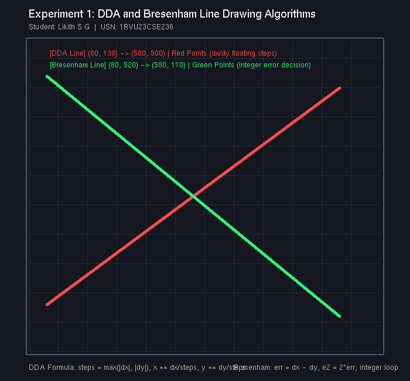

# Experiment 1: DDA and Bresenham Line Drawing Algorithms

**Student Name:** Likith S G  
**USN:** 1RVU23CSE236  
**Course:** Computer Graphics and Virtual Reality Laboratory  

---

## 1. Objective
To implement, analyze, and compare the two classic 2D rasterization algorithms for line generation:
- **Digital Differential Analyzer (DDA)** algorithm.
- **Bresenham's Line Drawing** algorithm.

---

## 2. Theoretical Overview
Line generation algorithms determine the optimal sequence of pixels on a discrete integer raster grid that closely approximates an ideal continuous mathematical line defined between two endpoints $(x_1, y_1)$ and $(x_2, y_2)$.

### A. Digital Differential Analyzer (DDA)
The DDA algorithm calculates step increments based on the differential equation of a line ($dy/dx = m$). It computes the major driving axis ($steps = \max(|dx|, |dy|)$) and increments coordinates by floating-point values $\Delta x$ and $\Delta y$, rounding to the nearest integer pixel.

### B. Bresenham's Line Drawing Algorithm
Bresenham's algorithm utilizes pure integer arithmetic by defining an error term that tracks the distance between the actual mathematical line and the nearest discrete pixel center. By multiplying the decision parameter by $2$, division and floating-point computations are completely eliminated, making it computationally superior for hardware and real-time graphics pipelines.

---

## 3. Mathematical Formulas

### DDA Formulation
1. **Coordinate Differences:**  
   $$\Delta x = x_2 - x_1, \quad \Delta y = y_2 - y_1$$
2. **Number of Steps:**  
   $$\text{steps} = \max(|\Delta x|, |\Delta y|)$$
3. **Per-Step Increments:**  
   $$x_{\text{inc}} = \frac{\Delta x}{\text{steps}}, \quad y_{\text{inc}} = \frac{\Delta y}{\text{steps}}$$
4. **Point Iteration:**  
   $$x_{k+1} = x_k + x_{\text{inc}}, \quad y_{k+1} = y_k + y_{\text{inc}}$$
   $$\text{Plotted Pixel: } (\text{round}(x_k), \text{round}(y_k))$$

### Bresenham Formulation (All-Octant Implementation)
1. **Absolute Deltas and Stepping Direction:**  
   $$dx = |x_2 - x_1|, \quad dy = |y_2 - y_1|$$
   $$s_x = \begin{cases} 1 & \text{if } x_1 < x_2 \\ -1 & \text{otherwise} \end{cases}, \quad s_y = \begin{cases} 1 & \text{if } y_1 < y_2 \\ -1 & \text{otherwise} \end{cases}$$
2. **Initial Error Parameter:**  
   $$\text{err} = dx - dy$$
3. **Iterative Update Decision:**  
   $$e_2 = 2 \cdot \text{err}$$
   - If $e_2 > -dy$: $\text{err} \leftarrow \text{err} - dy, \quad x_1 \leftarrow x_1 + s_x$
   - If $e_2 < dx$: $\text{err} \leftarrow \text{err} + dx, \quad y_1 \leftarrow y_1 + s_y$

---

## 4. Implementation Details
- **File:** [`exp1.py`](exp1.py)
- **Library:** PyOpenGL, GLUT
- **Features:**
  - Red line rendered using the DDA algorithm from $(80, 130)$ to $(580, 500)$.
  - Green line rendered using Bresenham's algorithm from $(80, 520)$ to $(580, 110)$.
  - Annotated coordinate grid, labels, and mathematical summary.
  - Interactive window display and `--headless` automated screenshot capture.

---

## 5. Visual Output


---

## 6. How to Run
```bash
# Interactive Mode
python experiments/Experiment_1/exp1.py

# Headless / Screenshot Capture Mode
python experiments/Experiment_1/exp1.py --headless
```
