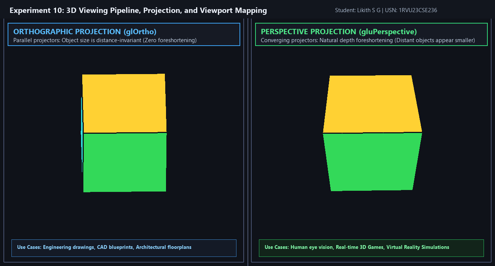

# Experiment 10: 3D Viewing Pipeline, Projection, and Viewport Mapping

**Student Name:** Likith S G  
**USN:** 1RVU23CSE236  
**Course:** Computer Graphics and Virtual Reality Laboratory  

---

## 1. Objective
To implement and demonstrate the complete **3D Viewing Pipeline**, illustrating how 3D world models are converted into a 2D screen image through coordinate transformations, and comparing **Orthographic Projection** vs. **Perspective Projection** in synchronized side-by-side viewports.

---

## 2. Theoretical Overview
Rendering a 3D scene onto a discrete 2D screen requires a sequence of mathematical coordinate spaces:
```text
[Object Space] ──Model Matrix──> [World Space] ──View Matrix──> [Eye/Camera Space]
                                                                        │
                                                                 Projection Matrix
                                                                        │
                                                                        ▼
[Screen Viewport] <──Viewport Mapping── [Normalized Device Coord (NDC)] <── [Clip Space]
```

### Orthographic vs. Perspective Projection
- **Orthographic Projection (`glOrtho`):** Uses parallel projector lines perpendicular to the projection plane. Object dimensions are invariant to camera distance, preserving parallel lines and physical scale (ideal for engineering, CAD, and technical blueprints).
- **Perspective Projection (`gluPerspective`):** Projectors converge at a single center of projection (the camera lens/eye). Objects farther from the camera appear smaller due to depth foreshortening, accurately modeling real-world human vision.

---

## 3. Mathematical Formulas

### 1. View Matrix Transformation (`gluLookAt`)
Transforms world coordinates to eye coordinates based on camera eye position $\vec{E}$, target point $\vec{T}$, and up vector $\vec{U}$:
$$\vec{z}_c = \frac{\vec{E} - \vec{T}}{\|\vec{E} - \vec{T}\|}, \quad \vec{x}_c = \frac{\vec{U} \times \vec{z}_c}{\|\vec{U} \times \vec{z}_c\|}, \quad \vec{y}_c = \vec{z}_c \times \vec{x}_c$$
$$M_{\text{view}} = \begin{bmatrix} x_{cx} & x_{cy} & x_{cz} & -\vec{x}_c \cdot \vec{E} \\ y_{cx} & y_{cy} & y_{cz} & -\vec{y}_c \cdot \vec{E} \\ z_{cx} & z_{cy} & z_{cz} & -\vec{z}_c \cdot \vec{E} \\ 0 & 0 & 0 & 1 \end{bmatrix}$$

### 2. Orthographic Projection Matrix (`glOrtho`)
Maps bounding box $[l, r] \times [b, t] \times [-n, -f]$ into NDC $[-1, 1]^3$:
$$M_{\text{ortho}} = \begin{bmatrix} \frac{2}{r - l} & 0 & 0 & -\frac{r + l}{r - l} \\ 0 & \frac{2}{t - b} & 0 & -\frac{t + b}{t - b} \\ 0 & 0 & -\frac{2}{f - n} & -\frac{f + n}{f - n} \\ 0 & 0 & 0 & 1 \end{bmatrix}$$

### 3. Perspective Projection Matrix (`gluPerspective`)
For field-of-view angle $\theta$, aspect ratio $a = w/h$, near plane $n$, and far plane $f$:
$$d = \cot\left(\frac{\theta}{2}\right)$$
$$M_{\text{persp}} = \begin{bmatrix} \frac{d}{a} & 0 & 0 & 0 \\ 0 & d & 0 & 0 \\ 0 & 0 & -\frac{f + n}{f - n} & -\frac{2fn}{f - n} \\ 0 & 0 & -1 & 0 \end{bmatrix}$$

### 4. Viewport Mapping
Transforms normalized device coordinates $(x_{\text{ndc}}, y_{\text{ndc}}) \in [-1, 1]^2$ to physical pixel coordinates $(x_s, y_s)$ within viewport rectangle $(x_v, y_v, w_v, h_v)$:
$$x_s = x_v + \frac{x_{\text{ndc}} + 1}{2} \cdot w_v, \quad y_s = y_v + \frac{y_{\text{ndc}} + 1}{2} \cdot h_v$$

---

## 4. Implementation Details
- **File:** [`exp10.py`](exp10.py)
- **Library:** PyOpenGL, GLFW, Pillow
- **Features:**
  - Dual synchronized viewports with identical 3D camera pose ($\text{Eye}=(4.0, 3.2, 6.0)$, $\text{Target}=(0, 0, 0)$).
  - Multi-colored 3D cube with black wireframe silhouette edges.
  - Left Viewport: Orthographic projection.
  - Right Viewport: Perspective projection with natural foreshortening.
  - Automated high-resolution screenshot (`output.png`) and recorded rotation GIF (`demo.gif`).

---

## 5. Visual Output

### Static Frame Screenshot


### Live Animation (GIF)


---

## 6. How to Run
```bash
# Interactive Mode
python experiments/Experiment_10/exp10.py

# Headless Screenshot & GIF Generation Mode
python experiments/Experiment_10/exp10.py --headless
```
