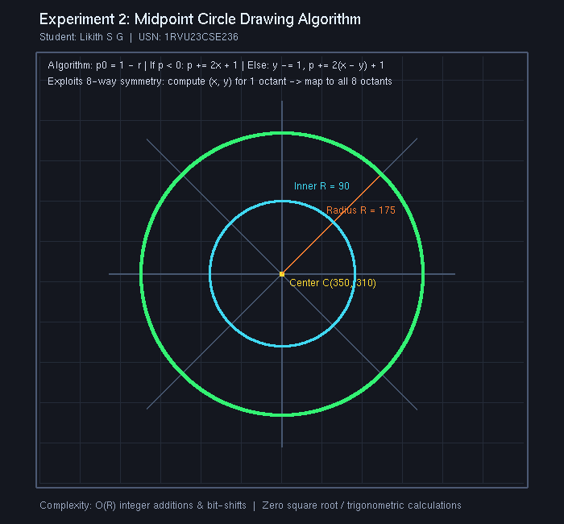

# Experiment 2: Midpoint Circle Drawing Algorithm

**Student Name:** Likith S G  
**USN:** 1RVU23CSE236  
**Course:** Computer Graphics and Virtual Reality Laboratory  

---

## 1. Objective
To implement the **Midpoint Circle Drawing Algorithm** in Python using OpenGL to rasterize circles efficiently using integer-only arithmetic and 8-way symmetry.

---

## 2. Theoretical Overview
Directly calculating circle coordinates via the Cartesian formula ($y = \pm\sqrt{r^2 - x^2}$) or polar trigonometry ($x = r\cos\theta, y = r\sin\theta$) involves expensive floating-point and transcendental functions with non-uniform pixel spacing.

The Midpoint Circle Algorithm evaluates the implicit circle function:
$$f(x, y) = x^2 + y^2 - r^2$$
At each step along the first octant ($x = 0$ to $x = y$), the midpoint between candidate pixels $E(x+1, y)$ and $SE(x+1, y-1)$ is tested. Because a circle possesses 8-fold symmetry across octants, calculating one octant allows immediate reflection to the remaining seven octants.

---

## 3. Mathematical Formulas

1. **Initial Decision Parameter:**  
   Starting at $(x_0, y_0) = (0, r)$:
   $$p_0 = f\left(1, r - \frac{1}{2}\right) = 1 + \left(r - \frac{1}{2}\right)^2 - r^2 = \frac{5}{4} - r \approx 1 - r \quad (\text{integer approximation})$$
2. **Iterative Decision Logic:**  
   At step $k$:
   - **If $p_k < 0$ (Midpoint is inside the circle):**  
     Choose East pixel $(x_{k+1}, y_{k+1}) = (x_k + 1, y_k)$:
     $$p_{k+1} = p_k + 2x_{k+1} + 1$$
   - **If $p_k \ge 0$ (Midpoint is outside or on the circle):**  
     Choose South-East pixel $(x_{k+1}, y_{k+1}) = (x_k + 1, y_k - 1)$:
     $$p_{k+1} = p_k + 2(x_{k+1} - y_{k+1}) + 1$$
3. **8-Way Symmetric Plotting:**  
   For any computed point $(x, y)$ relative to center $(x_c, y_c)$:
   $$\begin{matrix}
   (x_c + x, y_c + y), & (x_c - x, y_c + y), & (x_c + x, y_c - y), & (x_c - x, y_c - y) \\
   (x_c + y, y_c + x), & (x_c - y, y_c + x), & (x_c + y, y_c - x), & (x_c - y, y_c - x)
   \end{matrix}$$

---

## 4. Implementation Details
- **File:** [`exp2.py`](exp2.py)
- **Library:** PyOpenGL, GLUT
- **Features:**
  - Primary circle rendered with center $(350, 310)$ and radius $R = 175$ in bright emerald green.
  - Inner concentric circle rendered with radius $R = 90$ in cyan.
  - Center crosshair, radius vector, 8-fold symmetry axis guides, and parameter labels.
  - Supports `--headless` screenshot generation and interactive display.

---

## 5. Visual Output


---

## 6. How to Run
```bash
# Interactive Mode
python experiments/Experiment_2/exp2.py

# Headless / Screenshot Capture Mode
python experiments/Experiment_2/exp2.py --headless
```
