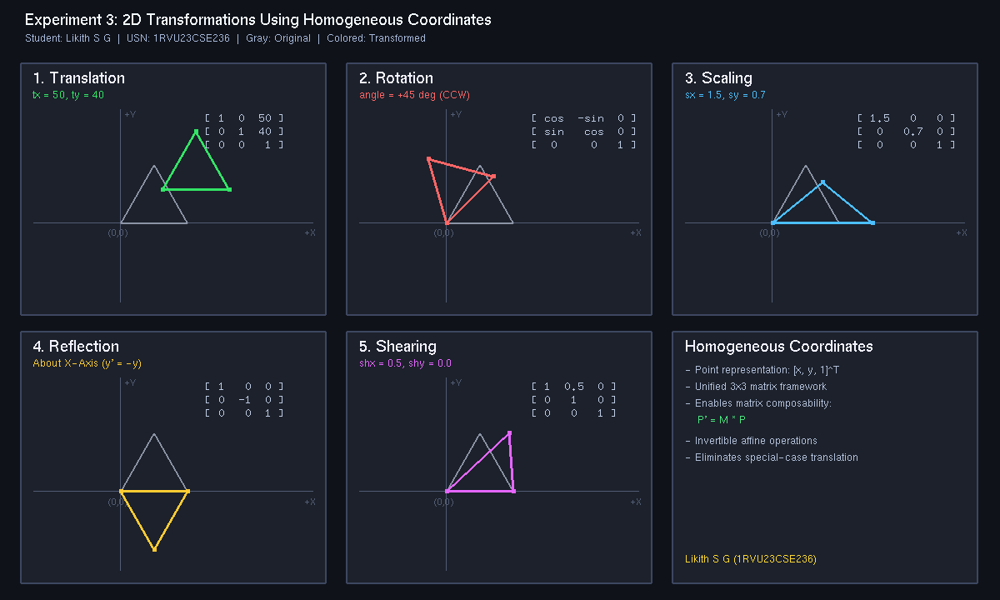

# Experiment 3: 2D Transformations Using Homogeneous Coordinates

**Student Name:** Likith S G  
**USN:** 1RVU23CSE236  
**Course:** Computer Graphics and Virtual Reality Laboratory  

---

## 1. Objective
To implement fundamental 2D geometric transformations using $3 \times 3$ homogeneous coordinate matrices in Python with OpenGL, demonstrating Translation, Rotation, Scaling, Reflection, and Shearing.

---

## 2. Theoretical Overview
In 2D Cartesian coordinates, affine transformations such as rotation and scaling are expressed as matrix multiplications, while translation requires vector addition. To represent all affine transformations as unified matrix multiplications, **homogeneous coordinates** augment 2D points into a 3D projective space:
$$P = \begin{bmatrix} x \\ y \\ 1 \end{bmatrix}$$
This allows arbitrary transformation sequences to be multiplied and combined into a single $3 \times 3$ matrix.

---

## 3. Mathematical Formulas

### 1. Translation Matrix $T(t_x, t_y)$
$$T(t_x, t_y) = \begin{bmatrix} 1 & 0 & t_x \\ 0 & 1 & t_y \\ 0 & 0 & 1 \end{bmatrix}, \quad \begin{bmatrix} x' \\ y' \\ 1 \end{bmatrix} = \begin{bmatrix} x + t_x \\ y + t_y \\ 1 \end{bmatrix}$$

### 2. Rotation Matrix $R(\theta)$ (Counterclockwise by angle $\theta$)
$$R(\theta) = \begin{bmatrix} \cos\theta & -\sin\theta & 0 \\ \sin\theta & \cos\theta & 0 \\ 0 & 0 & 1 \end{bmatrix}$$

### 3. Scaling Matrix $S(s_x, s_y)$
$$S(s_x, s_y) = \begin{bmatrix} s_x & 0 & 0 \\ 0 & s_y & 0 \\ 0 & 0 & 1 \end{bmatrix}, \quad \begin{bmatrix} x' \\ y' \\ 1 \end{bmatrix} = \begin{bmatrix} s_x \cdot x \\ s_y \cdot y \\ 1 \end{bmatrix}$$

### 4. Reflection Matrix (Across X-Axis)
$$\text{Ref}_x = \begin{bmatrix} 1 & 0 & 0 \\ 0 & -1 & 0 \\ 0 & 0 & 1 \end{bmatrix}, \quad \begin{bmatrix} x' \\ y' \\ 1 \end{bmatrix} = \begin{bmatrix} x \\ -y \\ 1 \end{bmatrix}$$

### 5. Shearing Matrix $Sh(sh_x, sh_y)$
$$Sh(sh_x, sh_y) = \begin{bmatrix} 1 & sh_x & 0 \\ sh_y & 1 & 0 \\ 0 & 0 & 1 \end{bmatrix}, \quad \begin{bmatrix} x' \\ y' \\ 1 \end{bmatrix} = \begin{bmatrix} x + sh_x \cdot y \\ y + sh_y \cdot x \\ 1 \end{bmatrix}$$

---

## 4. Implementation Details
- **File:** [`exp3.py`](exp3.py)
- **Library:** PyOpenGL, GLUT
- **Features:**
  - 6 dedicated panels in a $3 \times 2$ grid comparing the original polygon (gray) against the transformed polygon (colored).
  - Explicit $3 \times 3$ matrix display on each panel showing numerical parameters.
  - Interactive display and `--headless` screenshot capture mode.

---

## 5. Visual Output


---

## 6. How to Run
```bash
# Interactive Mode
python experiments/Experiment_3/exp3.py

# Headless / Screenshot Capture Mode
python experiments/Experiment_3/exp3.py --headless
```
