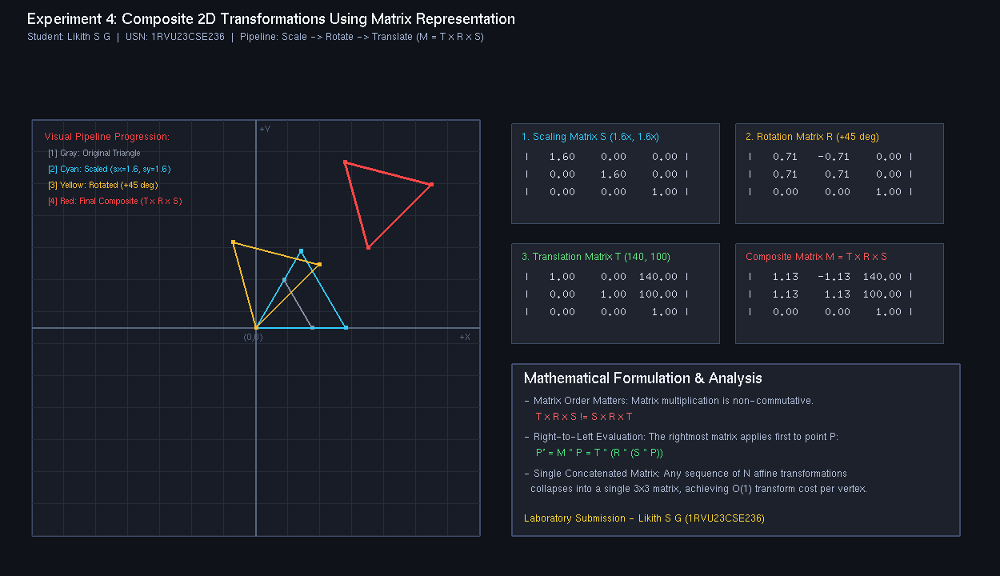

# Experiment 4: Composite 2D Transformations Using Matrix Representation

**Student Name:** Likith S G  
**USN:** 1RVU23CSE236  
**Course:** Computer Graphics and Virtual Reality Laboratory  

---

## 1. Objective
To implement composite 2D geometric transformations using homogeneous coordinate matrix multiplication in Python with OpenGL, demonstrating a sequential transformation pipeline (Scale $\to$ Rotate $\to$ Translate) and illustrating the property of matrix non-commutativity.

---

## 2. Theoretical Overview
When multiple affine transformations are sequentially applied to a graphic model, performing separate vertex updates for each transformation stage is computationally inefficient ($O(n \times m)$ where $n$ is vertices and $m$ is transformations).

Because homogeneous coordinate transformations are linear matrix multiplications, the entire sequence of operations can be concatenated into a single composite matrix:
$$M = M_k \times M_{k-1} \times \cdots \times M_1$$
Once $M$ is precomputed, every vertex in the model is transformed with a single $3 \times 3$ matrix multiplication ($P' = M \times P$), achieving $O(1)$ transformation cost per vertex.

---

## 3. Mathematical Formulas

### Transformation Pipeline Sequence
1. **Scaling ($S$):** Scales geometry by factors $s_x = 1.6, s_y = 1.6$.
   $$S = \begin{bmatrix} 1.6 & 0 & 0 \\ 0 & 1.6 & 0 \\ 0 & 0 & 1 \end{bmatrix}$$
2. **Rotation ($R$):** Rotates by $\theta = +45^\circ$ counterclockwise.
   $$R = \begin{bmatrix} \cos 45^\circ & -\sin 45^\circ & 0 \\ \sin 45^\circ & \cos 45^\circ & 0 \\ 0 & 0 & 1 \end{bmatrix} \approx \begin{bmatrix} 0.71 & -0.71 & 0 \\ 0.71 & 0.71 & 0 \\ 0 & 0 & 1 \end{bmatrix}$$
3. **Translation ($T$):** Translates by displacements $t_x = 140, t_y = 100$.
   $$T = \begin{bmatrix} 1 & 0 & 140 \\ 0 & 1 & 100 \\ 0 & 0 & 1 \end{bmatrix}$$

### Composite Matrix Formulation
Because operations evaluate from right to left:
$$P' = T \times (R \times (S \times P)) = (T \times R \times S) \times P$$
$$M = T \times R \times S$$

**Non-Commutativity Note:** Matrix multiplication is non-commutative:
$$T \times R \times S \neq S \times R \times T$$
The geometric sequence of operations fundamentally alters the final placement and orientation.

---

## 4. Implementation Details
- **File:** [`exp4.py`](exp4.py)
- **Library:** PyOpenGL, GLUT
- **Features:**
  - Visual stage progression showing Original (gray), Scaled (cyan), Rotated (yellow), and Final Composite (vibrant red-coral).
  - Explicit numerical matrix display boxes for $S$, $R$, $T$, and composite $M$.
  - Interactive mode and `--headless` automated capture mode.

---

## 5. Visual Output


---

## 6. How to Run
```bash
# Interactive Mode
python experiments/Experiment_4/exp4.py

# Headless / Screenshot Capture Mode
python experiments/Experiment_4/exp4.py --headless
```
