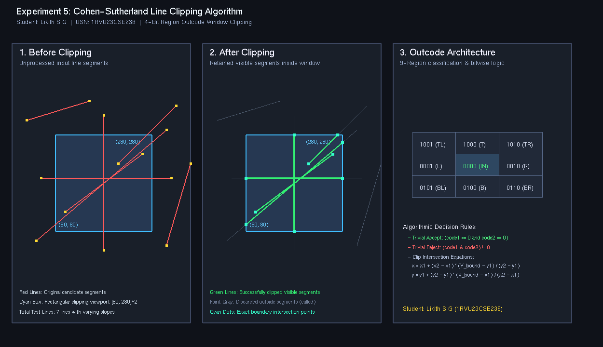

# Experiment 5: Cohen-Sutherland Line Clipping Algorithm

**Student Name:** Likith S G  
**USN:** 1RVU23CSE236  
**Course:** Computer Graphics and Virtual Reality Laboratory  

---

## 1. Objective
To implement the **Cohen-Sutherland Line Clipping Algorithm** in Python using OpenGL to clip arbitrary 2D line segments against a rectangular viewing window using 4-bit region outcodes and line-boundary intersection calculations.

---

## 2. Theoretical Overview
Clipping is the process of extracting the portion of a graphical primitive that lies within a designated clipping window or viewport, discarding fragments outside the visible area. 

The Cohen-Sutherland algorithm divides 2D space into nine regions relative to a rectangular window $[X_{\min}, X_{\max}] \times [Y_{\min}, Y_{\max}]$. Each endpoint is assigned a 4-bit region code (outcode):
- **Bit 1 (Top):** 1 if $y > Y_{\max}$, else 0.
- **Bit 2 (Bottom):** 1 if $y < Y_{\min}$, else 0.
- **Bit 3 (Right):** 1 if $x > X_{\max}$, else 0.
- **Bit 4 (Left):** 1 if $x < X_{\min}$, else 0.

---

## 3. Mathematical Formulas

### 4-Bit Region Outcode Layout
$$\begin{array}{c|c|c}
1001 \text{ (Top-Left)} & 1000 \text{ (Top)} & 1010 \text{ (Top-Right)} \\
\hline
0001 \text{ (Left)} & 0000 \text{ (Inside Window)} & 0010 \text{ (Right)} \\
\hline
0101 \text{ (Bottom-Left)} & 0100 \text{ (Bottom)} & 0110 \text{ (Bottom-Right)}
\end{array}$$

### Decision Rules
1. **Trivial Accept:** If $\text{code}_1 = 0000$ and $\text{code}_2 = 0000$ (both endpoints inside).
2. **Trivial Reject:** If $(\text{code}_1 \ \& \ \text{code}_2) \neq 0$ (both endpoints lie completely on one outside side).
3. **Clipping Iteration:** If neither applies, an outside point is selected and clipped against the intersected boundary:
   - **Intersection with Top ($y = Y_{\max}$):**
     $$x = x_1 + (x_2 - x_1) \cdot \frac{Y_{\max} - y_1}{y_2 - y_1}, \quad y = Y_{\max}$$
   - **Intersection with Bottom ($y = Y_{\min}$):**
     $$x = x_1 + (x_2 - x_1) \cdot \frac{Y_{\min} - y_1}{y_2 - y_1}, \quad y = Y_{\min}$$
   - **Intersection with Right ($x = X_{\max}$):**
     $$y = y_1 + (y_2 - y_1) \cdot \frac{X_{\max} - x_1}{x_2 - x_1}, \quad x = X_{\max}$$
   - **Intersection with Left ($x = X_{\min}$):**
     $$y = y_1 + (y_2 - y_1) \cdot \frac{X_{\min} - x_1}{x_2 - x_1}, \quad x = X_{\min}$$

---

## 4. Implementation Details
- **File:** [`exp5.py`](exp5.py)
- **Library:** PyOpenGL, GLUT
- **Features:**
  - Panel 1: Original test lines before clipping against $[80, 280] \times [80, 280]$ window.
  - Panel 2: Clipped lines showing retained segments in vibrant green and discarded fragments in faint gray.
  - Panel 3: 4-bit region code layout diagram with bitwise logic rules and formulas.
  - Supports `--headless` screenshot generation and interactive display.

---

## 5. Visual Output


---

## 6. How to Run
```bash
# Interactive Mode
python experiments/Experiment_5/exp5.py

# Headless / Screenshot Capture Mode
python experiments/Experiment_5/exp5.py --headless
```
