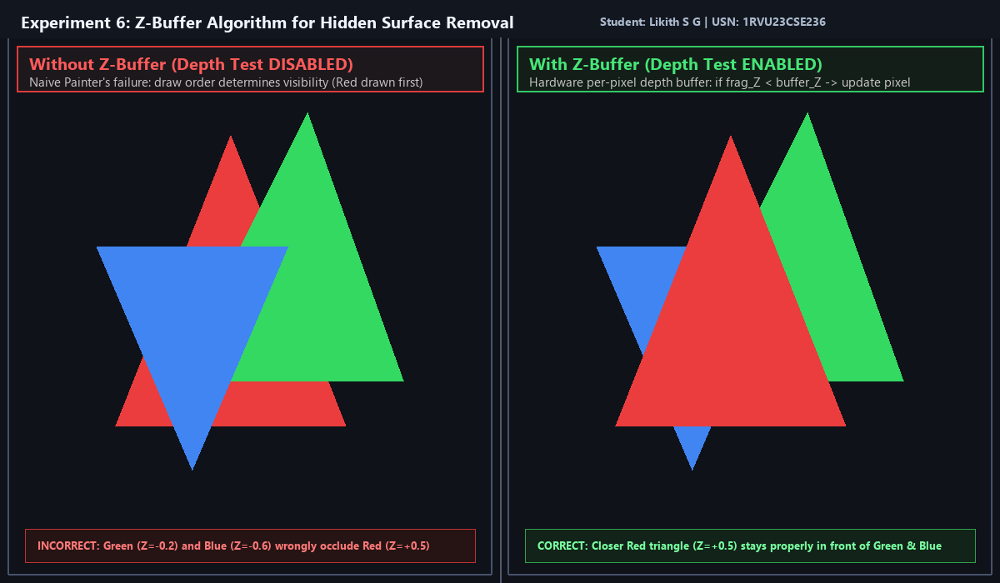

# Experiment 6: Z-Buffer Algorithm for Hidden Surface Removal

**Student Name:** Likith S G  
**USN:** 1RVU23CSE236  
**Course:** Computer Graphics and Virtual Reality Laboratory  

---

## 1. Objective
To implement and analyze the **Z-Buffer (Depth-Buffer) Algorithm** in Python using OpenGL and GLFW, demonstrating how hidden surface removal is achieved per pixel and contrasting it with the failure of the naive Painter's Algorithm.

---

## 2. Theoretical Overview
In 3D computer graphics, hidden surface removal ensures that surfaces closer to the observer occlude surfaces farther away. 

### Limitations of Object-Space Painter's Algorithm
The classic Painter's algorithm sorts polygons from back to front and draws them sequentially. However, it fails when polygons overlap cyclically, pierce one another, or when polygons are submitted out of strict depth order, causing farther polygons to overwrite closer ones.

### Image-Space Z-Buffer Algorithm
The Z-buffer algorithm operates at fragment/pixel resolution. It maintains two parallel buffers:
1. **Color (Frame) Buffer:** Stores the RGB color of the currently visible surface at $(x, y)$.
2. **Depth (Z) Buffer:** Stores the closest depth value $z \in [0, 1]$ encountered so far for each pixel $(x, y)$.

When rasterizing a fragment with calculated depth $z_{\text{frag}}$ at $(x, y)$:
- If $z_{\text{frag}} < Z_{\text{buffer}}(x, y)$ (closer to viewer under `GL_LESS`):
  - $Z_{\text{buffer}}(x, y) \leftarrow z_{\text{frag}}$
  - $\text{ColorBuffer}(x, y) \leftarrow \text{Color}_{\text{frag}}$
- Otherwise, the incoming fragment is discarded as occluded.

---

## 3. Mathematical Formulas

### Planar Depth Interpolation
For a polygon with plane equation $Ax + By + Cz + D = 0$, the depth $z$ at screen coordinate $(x, y)$ is:
$$z = \frac{-Ax - By - D}{C}$$

When rasterizing along a horizontal scanline ($\Delta x = 1, \Delta y = 0$):
$$z(x+1, y) = z(x, y) - \frac{A}{C}$$
This linear recurrence allows depth to be computed with a single addition per pixel across each scanline.

---

## 4. Implementation Details
- **File:** [`exp6.py`](exp6.py)
- **Library:** PyOpenGL, GLFW, Pillow
- **Features:**
  - Dual synchronized viewports:
    - **Left Viewport (Depth Test DISABLED):** Demonstrates Painter's algorithm failure where green ($Z=-0.2$) and blue ($Z=-0.6$) triangles incorrectly occlude the closer red triangle ($Z=+0.5$).
    - **Right Viewport (Depth Test ENABLED):** Demonstrates hardware Z-buffering resolving visibility correctly per-pixel regardless of polygon drawing order.
  - Interactive render loop and automated `--headless` screenshot generation.

---

## 5. Visual Output


---

## 6. How to Run
```bash
# Interactive Mode
python experiments/Experiment_6/exp6.py

# Headless / Screenshot Capture Mode
python experiments/Experiment_6/exp6.py --headless
```
