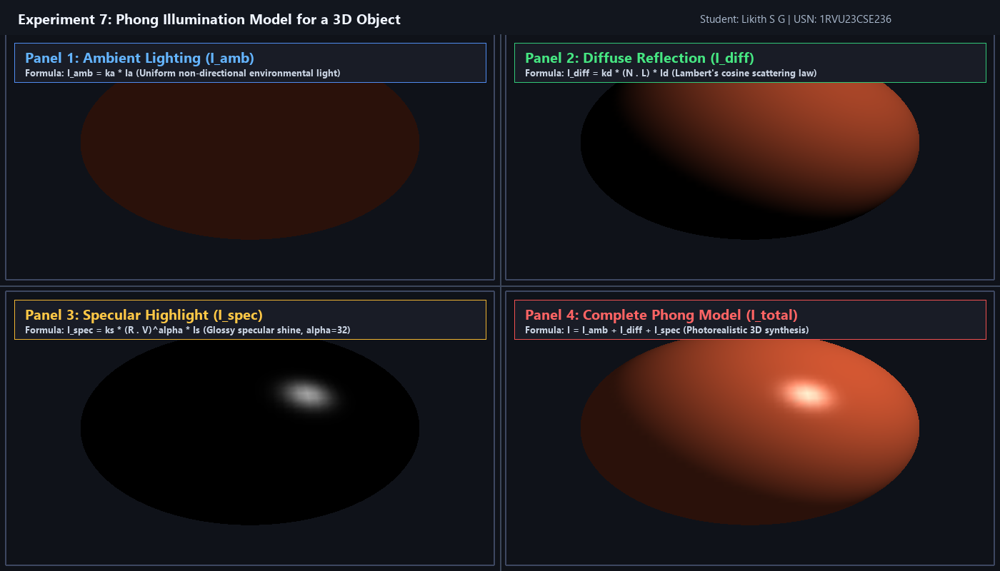

# Experiment 7: Phong Illumination Model for a 3D Object

**Student Name:** Likith S G  
**USN:** 1RVU23CSE236  
**Course:** Computer Graphics and Virtual Reality Laboratory  

---

## 1. Objective
To implement the **Phong Illumination Model** for a 3D object in Python using OpenGL and GLFW, demonstrating the individual and combined contributions of Ambient, Diffuse, and Specular reflection components.

---

## 2. Theoretical Overview
The Phong Illumination Model is an empirical local illumination formulation that models how light reflects from a surface based on three physical phenomena:
1. **Ambient Reflection ($I_{\text{ambient}}$):** Non-directional, uniform background light scattered through multiple bounces across the environment.
2. **Diffuse Reflection ($I_{\text{diffuse}}$):** Lambertian scattering from rough/matte surfaces where reflected intensity depends on the angle between the surface normal $\vec{N}$ and light direction vector $\vec{L}$.
3. **Specular Reflection ($I_{\text{specular}}$):** Glossy highlight reflecting off smooth surfaces in the direction of ideal mirror reflection $\vec{R}$ observed along viewer vector $\vec{V}$.

---

## 3. Mathematical Formulas

### Total Phong Illumination Equation
$$I = I_{\text{ambient}} + I_{\text{diffuse}} + I_{\text{specular}}$$
$$I = k_a I_a + k_d (\vec{N} \cdot \vec{L}) I_d + k_s (\vec{R} \cdot \vec{V})^\alpha I_s$$

### Vector Definitions and Calculations
- **Surface Normal ($\vec{N}$):** Unit normal vector perpendicular to the surface. For a unit sphere centered at origin, $\vec{N} = (x, y, z)$.
- **Light Vector ($\vec{L}$):** Normalized direction vector pointing from the surface towards the light source.
- **Viewer Vector ($\vec{V}$):** Normalized direction vector pointing towards the camera: $\vec{V} = (0, 0, 1)$.
- **Reflection Vector ($\vec{R}$):** Direction of perfect specular reflection:
  $$\vec{R} = 2(\vec{N} \cdot \vec{L})\vec{N} - \vec{L}$$
- **Shininess Exponent ($\alpha$):** Parameter controlling specular sharpness ($\alpha = 32.0$). High values produce tight, sharp highlights (plastic/metallic gloss).

### Component Breakdown
1. **Ambient Component:**
   $$I_{\text{ambient}} = k_a I_a$$
2. **Diffuse Component (Lambert's Cosine Law):**
   $$I_{\text{diffuse}} = k_d \max(0, \vec{N} \cdot \vec{L}) I_d$$
3. **Specular Component:**
   $$I_{\text{specular}} = k_s \max(0, \vec{R} \cdot \vec{V})^\alpha I_s$$

---

## 4. Implementation Details
- **File:** [`exp7.py`](exp7.py)
- **Library:** PyOpenGL, GLFW, Pillow
- **Features:**
  - Synchronized four-quadrant decomposition of a 3D tessellated sphere:
    - Quadrant 1: Ambient component only.
    - Quadrant 2: Diffuse component only.
    - Quadrant 3: Specular highlight only.
    - Quadrant 4: Full combined Phong illumination model.
  - Interactive render loop and automated `--headless` screenshot generation.

---

## 5. Visual Output


---

## 6. How to Run
```bash
# Interactive Mode
python experiments/Experiment_7/exp7.py

# Headless / Screenshot Capture Mode
python experiments/Experiment_7/exp7.py --headless
```
