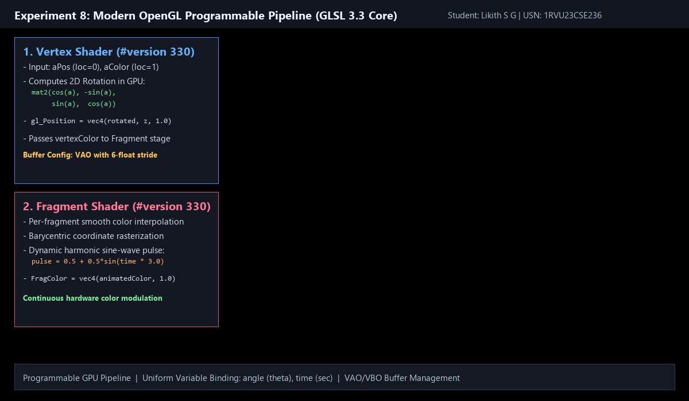
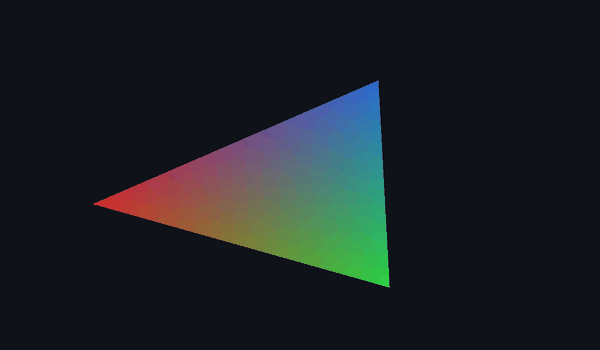

# Experiment 8: OpenGL Vertex and Fragment Shaders

**Student Name:** Likith S G  
**USN:** 1RVU23CSE236  
**Course:** Computer Graphics and Virtual Reality Laboratory  

---

## 1. Objective
To develop a modern programmable OpenGL program using **GLSL (OpenGL Shading Language) 3.3 Core Profile**, demonstrating GPU buffer management (VAO/VBO), vertex transformations in the Vertex Shader, and color interpolation with time pulsation in the Fragment Shader.

---

## 2. Theoretical Overview
Modern OpenGL (3.3+ Core Profile) deprecated the fixed-function pipeline (`glBegin`/`glEnd`, built-in matrices) in favor of a fully programmable GPU pipeline. 

### Pipeline Architecture
```text
[Vertex Data (VBO)] -> [Vertex Array Object (VAO)]
                            │
                            ▼
                    [Vertex Shader] (Transforms positions & passes attributes)
                            │
                            ▼
                    [Primitive Assembly & Rasterization] (Interpolates varyings)
                            │
                            ▼
                    [Fragment Shader] (Calculates final pixel color)
                            │
                            ▼
                    [Framebuffer] (Screen display)
```

---

## 3. Mathematical Formulas and Shader Code

### 1. Vertex Shader (GLSL 330 Core)
Transforms 2D vertex positions by a rotation matrix modulated by a uniform angle variable $\theta$:
$$\begin{bmatrix} x' \\ y' \end{bmatrix} = \begin{bmatrix} \cos\theta & -\sin\theta \\ \sin\theta & \cos\theta \end{bmatrix} \begin{bmatrix} x \\ y \end{bmatrix}$$
$$\text{gl\_Position} = \begin{bmatrix} x' \\ y' \\ z \\ 1.0 \end{bmatrix}, \quad \text{vertexColor} = \text{aColor}$$

### 2. Fragment Shader (GLSL 330 Core)
Interpolates vertex colors smoothly across the triangle using barycentric coordinates and applies a continuous sine-wave time pulsation:
$$\text{pulse}(t) = 0.5 + 0.5 \sin(3.0 \cdot t)$$
$$\text{animatedColor} = \text{vertexColor} \times (0.75 + 0.25 \cdot \text{pulse}(t))$$
$$\text{FragColor} = \text{vec4}(\text{animatedColor}, 1.0)$$

### 3. Buffer Objects
- **VBO (Vertex Buffer Object):** High-speed GPU video memory buffer containing interleaved vertex positions $(x, y, z)$ and colors $(r, g, b)$ with a 6-float stride.
- **VAO (Vertex Array Object):** Stores vertex attribute configurations and state pointers.

---

## 4. Implementation Details
- **File:** [`exp8.py`](exp8.py)
- **Library:** PyOpenGL, GLFW, NumPy, Pillow
- **Features:**
  - Programmable pipeline with GLSL 3.3 shaders.
  - Real-time continuous rotation and color pulsation.
  - Automated high-resolution screenshot capture (`output.png`).
  - Animated gameplay/behavior GIF recording (`anim.gif`).

---

## 5. Visual Output

### Static Frame Screenshot


### Live Animation (GIF)


---

## 6. How to Run
```bash
# Interactive Mode
python experiments/Experiment_8/exp8.py

# Headless Screenshot & GIF Generation Mode
python experiments/Experiment_8/exp8.py --headless
```
