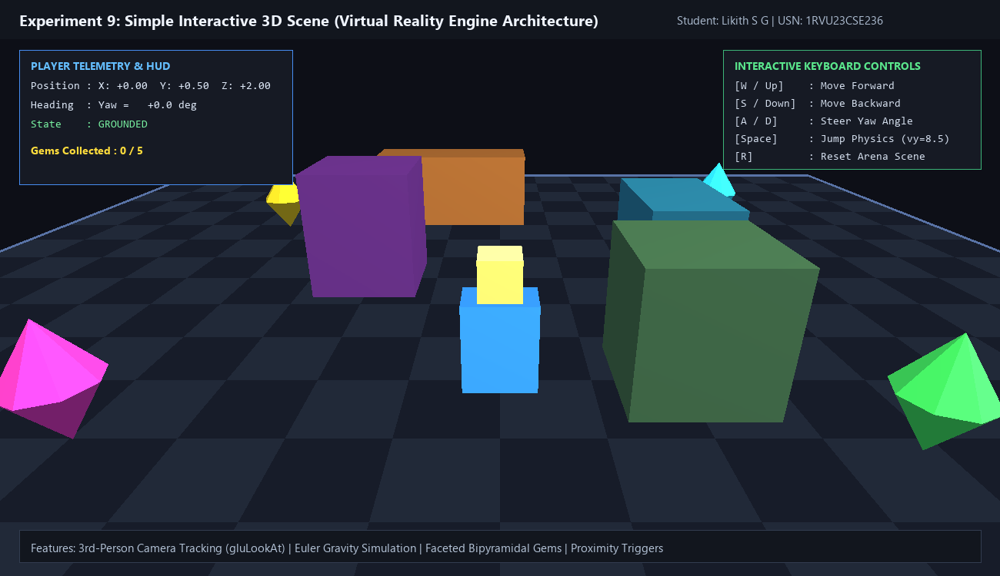

# Experiment 9: Simple Interactive 3D Scene

**Student Name:** Likith S G  
**USN:** 1RVU23CSE236  
**Course:** Computer Graphics and Virtual Reality Laboratory  

---

## 1. Objective
To design and implement a complete **interactive 3D virtual environment**, incorporating fundamental game engine and virtual reality architecture (as found in Unity) directly in Python using OpenGL.

---

## 2. Theoretical Overview
A modern 3D interactive graphics simulation integrates multiple concurrent subsystems:
1. **Scene Graph & World Representation:** Coordinate space defining static ground geometry, obstacles, and lighting models.
2. **Player Kinematics & Physical Simulation:** Character positioning, displacement vectors, yaw orientation, and discrete Euler numerical integration for gravity and jump mechanics.
3. **Camera Viewing Pipeline:** Dynamic third-person tracking computing view matrices based on player orientation.
4. **Interactive Dynamics & Collision Detection:** Proximity detection for collecting animated items.
5. **Heads-Up Display (HUD):** 2D screen overlay providing real-time telemetry, mission score, and user inputs.

---

## 3. Mathematical Formulas

### 1. Player Kinematics
- **Directional Velocity Displacements:**
  $$\Delta x = -v \cdot \Delta t \cdot \sin(\theta), \quad \Delta z = -v \cdot \Delta t \cdot \cos(\theta)$$
  where $v$ is linear movement speed ($7.0\text{ m/s}$) and $\theta$ is player yaw angle in radians.

### 2. Numerical Euler Gravity Integration
$$v_y(t + \Delta t) = v_y(t) - g \cdot \Delta t, \quad y(t + \Delta t) = y(t) + v_y(t) \cdot \Delta t$$
When grounded ($y \le 0.5\text{m}$), $v_y = 0$. On jump input: $v_y = 8.5\text{ m/s}$.

### 3. Third-Person Following Camera Pipeline
The camera position $\vec{C}$ tracks behind the player position $\vec{P}$ at distance $d = 5.2$ and height $h = 2.8$:
$$C_x = P_x - d \cdot \sin(\theta), \quad C_z = P_z + d \cdot \cos(\theta), \quad C_y = P_y + h$$
View matrix transformation via `gluLookAt`:
$$\text{gluLookAt}(C_x, C_y, C_z, P_x, P_y + 0.6, P_z, 0, 1, 0)$$

### 4. Collectible Gem Oscillation & Proximity Trigger
- **Continuous Yaw Spin:** $\phi(t) = \omega \cdot t$ ($\omega = 75^\circ/\text{s}$).
- **Vertical Harmonic Bobbing:** $y_{\text{gem}}(t) = y_0 + A \sin(\omega_{\text{bob}} t)$.
- **Euclidean Pickup Detection:** Triggered when:
  $$(P_x - C_x)^2 + (P_z - C_z)^2 < 1.4\text{ m}^2$$

---

## 4. Implementation Details
- **File:** [`exp9.py`](exp9.py)
- **Library:** PyOpenGL, GLFW, Pillow
- **Features:**
  - Checkered arena ground grid with perimeter boundary clamping.
  - Multi-colored 3D obstacle blocks with ambient and diffuse lighting.
  - 5 animated bipyramidal diamond gems with real-time pickup detection.
  - Third-person player avatar with head visor and jump physics.
  - Full HUD showing telemetry, controls, and gem counter.
  - Automated high-resolution screenshot (`output.png`) and recorded gameplay GIF (`demo.gif`).

---

## 5. Visual Output

### Static Frame Screenshot


### Live Gameplay Demo (GIF)


---

## 6. How to Run
```bash
# Interactive Mode (WASD / Arrows to move, Space to jump, R to reset)
python experiments/Experiment_9/exp9.py

# Headless Screenshot & Gameplay GIF Generation Mode
python experiments/Experiment_9/exp9.py --headless
```
